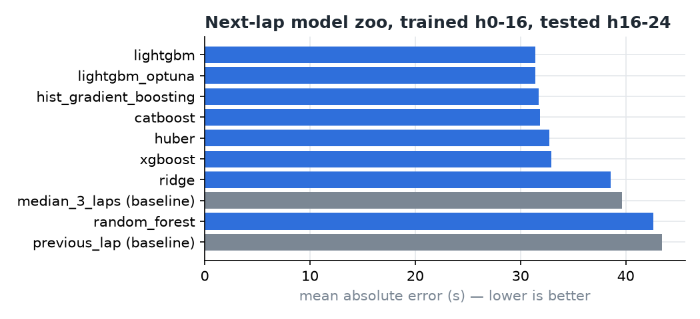

# 🏁 Motorsport Data Lab

**De la data science d'ingénieur de course sur de vraies données de chronométrage : les GT3 aux
24 Heures du Nürburgring (et au Mans), et le Championnat de France de Rallycross.**

[🇬🇧 English version](README.md) · Python 3.11–3.13 · licence MIT ·
ML : **Chronos-2**, **AutoGluon** (AWS), LightGBM, XGBoost, CatBoost, statsforecast, statsmodels, Optuna, SHAP

---

## En 30 secondes

| Quoi | D'où ça vient | Ce que ça donne |
|---|---|---|
| **4 445 tours de 43 GT3**, 24h du Nürburgring 2026, **plus 5 éditions précédentes** (2017–2023, 20 315 tours de GT3 au total) pour les tests à l'aveugle | PDF officiels ADAC / wige | relais, arrêts, conditions de piste, rythme par modèle, pilotes vs coéquipiers |
| **6 196 lignes de tours sur 7 meetings**, Championnat de France de Rallycross 2026 (Supercar + Super 1600) | résultats officiels ITS Chrono / FFSA | coût du joker par circuit, quand les pilotes le prennent, simulateur de stratégie joker |
| **Simulateur de stratégie** (Monte-Carlo, 24 h) | calibré sur la vraie course | prédit 157 tours ; la GT3 gagnante en a fait 156 |
| **Machine learning** : Chronos-2, AutoGluon, gradient boosting, ETS / ARIMA, intervalles conformes, SHAP | backtest glissant, découpage temporel | un résultat honnête, avec intervalles de confiance |
| **Statistiques** : note des pilotes par modèle mixte, modèle logistique des victoires en rallycross | statsmodels | qui est rapide dans sa voiture ; ce que vaut le moment du joker |
| **Qui prend le prochain relais ?** Style des pilotes à partir du chronométrage, et un agent qui apprend le rythme de chaque pilote pendant la course (bandit bayésien / apprentissage par renforcement) | simulateur calibré sur les 6 courses | +196 s par rapport à une rotation fixe ; le style de l'an dernier seul aide à peine |
| **Appli Streamlit bilingue** (FR/EN) | `app/streamlit_app.py` | tous les graphiques, en interactif |

Aucune donnée n'est inventée : tout vient des documents publics des chronométreurs officiels,
téléchargés et lus par le code de `src/motorsport_lab/sources/`.

---

## Essayer sans rien installer

[](https://colab.research.google.com/github/DARKQUAD/motorsport-data-lab/blob/main/notebooks/quickstart.ipynb) [](https://codespaces.new/DARKQUAD/motorsport-data-lab?quickstart=1)

| Où | Ce que tu obtiens | Ce qu'il faut |
|---|---|---|
| **Google Colab** | un notebook qui récupère le dépôt et lance les analyses principales : rythme, arrêts, coût du joker, zoo de modèles, test à l'aveugle sur plusieurs saisons, qui prend le prochain relais | un compte Google gratuit |
| **GitHub Codespaces** | tout le projet dans VS Code, dans le navigateur ; l'appli démarre toute seule (port 8501) | un compte GitHub gratuit (60 h / mois incluses) |
| **Streamlit Community Cloud** | un lien public vers l'appli | `streamlit_app.py` et `requirements.txt` sont prêts ; le propriétaire du dépôt la déploie en un clic |

---

## Le vocabulaire, simplement

| Mot | Sens |
|---|---|
| **GT3** | Voitures de course dérivées de la série (Porsche 911 GT3 R, BMW M4 GT3, Mercedes-AMG GT3…). Au Nürburgring elles courent en classe **SP 9**, au Mans en **LMGT3**. |
| **Temps au tour** | Le temps d'un tour. Tracé des 24h du Nürburgring = 25,4 km, soit environ **8 min 20 s**. |
| **Relais (stint)** | Les tours entre deux arrêts au stand. Au Nürburgring une GT3 fait **8 tours** par relais (limite d'essence). |
| **In-lap / out-lap** | Le tour qui rentre au stand, et celui qui en sort (arrêt compris). |
| **Code 60 / FCY** | Après un incident, des zones ou toute la piste sont limitées à 60 km/h. |
| **Indice de piste** | Notre mesure de la lenteur de tout le plateau à un instant donné (1,00 = normal, 1,20 = 20 % plus lent) : Code 60, pluie, brouillard, nuit. |
| **Joker lap** | Rallycross : un tracé alternatif plus long que chaque pilote doit prendre **une seule fois** par course. *Quand* le prendre, c'est de la stratégie. |
| **Monte-Carlo** | Simuler des milliers de courses aléatoires et regarder la moyenne et la dispersion des résultats. |
| **MAE** | Erreur absolue moyenne : la taille moyenne d'une erreur de prévision, en secondes. Plus bas = mieux. |
| **Référence (baseline)** | La règle simple qu'utiliserait un ingénieur (ex. « prochain tour = dernier tour propre »). Un modèle d'IA n'est utile que s'il fait mieux. |

---

## Résultats clés

### 1. 24h du Nürburgring 2026, GT3 uniquement


* **48 % de la course a été neutralisée ou mouillée** (indice de piste au-dessus de 1,06) : zones
  Code 60, brouillard, pluie. C'est pour ça que les temps bruts trompent, et que chaque comparaison
  est ici corrigée par l'indice de piste.
* **Arrêts au stand** : 591 arrêts ; un arrêt normal coûte **≈ 250 s** (in-lap + out-lap par rapport
  au rythme normal), et **24 s de plus** avec un changement de pilote (232 s → 256 s).
* **Modèles de voitures** (20 % meilleurs tours propres, corrigés des conditions) : la Lamborghini
  Huracán GT3 EVO2 est la plus rapide, puis Ford Mustang, Mercedes-AMG, Aston Martin et BMW à
  5–7 s au tour ([tableau](reports/n24/car_model_pace.csv)). C'est une lecture de la *balance de
  performance* (BoP), pas un jugement sur les voitures.
* **Les chronos seuls ne permettent pas d'isoler la dégradation des pneus au Nürburgring.** La pente
  intra-relais de chaque modèle a un intervalle à 95 % qui contient zéro (ex. Porsche : +0,16 s/tour,
  [−0,17 ; +0,50]). Avec plus de 140 voitures sur 25 km, le trafic pèse plus que l'usure. Une équipe
  ajouterait les données pneus et la télémétrie. On affiche la limite plutôt qu'un faux chiffre.


* **Simulateur de stratégie** calibré sur la vraie course (tour vert 8:20, relais de 8 tours, perte
  au stand, part de neutralisation) : il prédit **157 tours** pour une GT3 de tête ; la gagnante de la
  classe en a fait **156**. Sur les mêmes 3 000 courses simulées, **doubler les relais avec les mêmes
  pneus** est le meilleur plan dans 89 % des cas (+0,7 tour en moyenne), *si* l'usure vaut environ
  0,08 s par tour d'âge du pneu. Ce chiffre est une hypothèse, c'est donc un curseur dans l'appli.

### 2. Championnat de France de Rallycross 2026


* **Le joker coûte 2,0 s à Lohéac mais 5,2 s à Lessay** (Supercar, médiane par pilote face à ses
  propres tours normaux). Toute stratégie doit dépendre du circuit.
* Les pilotes prennent le joker **au 1er tour dans environ 25 %** des manches et des finales (15 % en
  demi-finale) et **au dernier tour dans 15–30 %** des cas. Les autres le prennent en milieu de course
  ([tableau](reports/rx_france/joker_timing.csv)).
* **Simulateur de joker** (finale Supercar de Lohéac, 8 voitures, 7 tours, chiffres de l'épreuve
  réelle) :


  Pour un pilote au rythme moyen : **en pole, prendre le joker tard** (tours 4–6) ; **depuis toute
  autre place, le prendre au 1er tour** pour éviter le trafic du premier virage. Les règles de trafic
  (de combien il faut être plus rapide pour doubler) sont des hypothèses modifiables dans l'appli.

### 3. Machine learning et statistiques : beaucoup d'outils, un seul juge honnête

Chaque modèle ci-dessous est comparé à la règle simple qu'utiliserait un ingénieur de course, sur des
données qu'il n'a jamais vues, avec un intervalle de **bootstrap par blocs** (on rééchantillonne des
blocs entiers voiture × moment, car les tours d'une même voiture sont liés). Un intervalle qui ne
touche pas zéro = une vraie différence.

**3a. Prévoir le prochain relais (8 tours ≈ 70 min).** Cinq instants de coupure pendant la course
(h4 → h20), 142 blocs voiture × coupure, 1 136 tours prévus. Les modèles savent quels tours futurs
sont des tours de stand (une équipe planifie ses arrêts).

| Modèle | Famille | MAE, tous les tours | MAE, tours propres | MAE, tours de stand |
|---|---|---|---|---|
| **Chronos-2** (zero-shot, avec covariables) | modèle de fondation (Amazon) | **43,0 s** | 20,4 s | 62,3 s |
| AutoTheta + perte au stand | statistiques (statsforecast) | 45,1 s | 12,7 s | 40,6 s |
| AutoETS + perte au stand | statistiques (statsforecast) | 45,3 s | **12,3 s** | **39,8 s** |
| Référence : dernier tour propre + perte au stand type | règle d'ingénieur | 46,0 s | 12,5 s | 40,1 s |
| Référence : médiane des 5 derniers tours propres + perte au stand | règle d'ingénieur | 46,0 s | 12,5 s | 40,8 s |
| AutoGluon-TimeSeries (preset rapide, ensemble) | AutoML (Amazon) | 54,6 s | 37,4 s | 67,1 s |
| AutoARIMA avec les tours de stand en régresseurs | statistiques | 55,1 s | 39,1 s | 62,0 s |

* Chronos-2 contre la référence : **−3,0 s, intervalle à 95 % [−6,5 ; +0,5], pas significatif** ; sur
  les tours propres il est **significativement moins bon** (+7,9 s, [+4,3 ; +12,2]).
* ETS et Theta sont **significativement meilleurs, mais de 0,7 à 0,9 s seulement** ([−1,2 ; −0,1] et
  [−1,7 ; −0,1]), et pas sur les tours propres. ARIMA et AutoGluon sont significativement moins bons
  ([tableau](reports/ml/forecast_significance.csv)).
* **Conclusion :** en endurance 24h, l'incertitude principale vient des neutralisations, qu'aucun
  historique de tours ne peut prévoir. Modéliser le rythme en piste verte par un simple lissage
  exponentiel et ajouter la perte au stand connue vaut autant que le reste : un gros modèle n'apporte
  rien ici.

**3b. Prédire le tour suivant : le zoo de modèles.** Les mêmes entrées pour tous (modèle de voiture,
numéro de pilote, tour dans le relais, heure de course, tour précédent, médiane des 3 derniers tours,
indice de piste des 10 dernières minutes). Entraînement sur les heures 0–16, test sur 16–24.



| Modèle | MAE, tous les tours en course | MAE, tours propres | écart au tour précédent, intervalle 95 % |
|---|---|---|---|
| **LightGBM** (perte L1) | **31,4 s** | **8,4 s** | −12,1 s [−35,0 ; −0,4] |
| LightGBM réglé avec **Optuna** (40 essais, validation = heures 12–16 seulement) | 31,4 s | 8,8 s | −12,0 s [−34,9 ; −0,4] |
| HistGradientBoosting de scikit-learn | 31,7 s | 8,4 s | −11,8 s [−34,7 ; −0,0] |
| CatBoost | 31,9 s | 8,5 s | −11,6 s [−34,5 ; +0,2] |
| Régression de Huber (linéaire robuste) | 32,7 s | 10,5 s | −10,7 s [−33,8 ; +1,2] |
| XGBoost | 32,9 s | 8,4 s | −10,6 s [−33,8 ; +1,5] |
| AutoGluon-Tabular (preset moyen) | 33,6 s | 10,4 s | |
| Régression ridge | 38,6 s | 18,3 s | −4,9 s [−26,5 ; +6,3] |
| Référence : médiane des 3 derniers tours | 39,7 s | 13,6 s | −3,8 s [−20,8 ; +5,0] |
| Forêt aléatoire | 42,6 s | 11,7 s | −0,9 s [−23,7 ; +12,8] |
| Référence : même temps que le tour précédent | 43,5 s | 10,7 s | 0 |

* Sur cette course, le gradient boosting gagne (LightGBM, HistGradientBoosting, CatBoost : moins de
  0,5 s d'écart entre eux ; **sur 5 autres courses cette avance disparaît, voir 3e**), **devant AutoGluon**, et c'est la seule famille dont l'avance sur la référence est
  significative. Les intervalles sont larges car quelques tours neutralisés coûtent des minutes.
* **Le réglage Optuna n'a pas aidé** sur les heures de test : les meilleurs réglages sur les heures
  12–16 ne se transposent pas à la nuit et au matin. C'est rapporté tel quel.
* **SHAP** (TreeSHAP intégré à LightGBM) : l'indice de piste des 10 dernières minutes explique le
  plus (19 s en moyenne), puis l'heure de course (15 s) et le tour précédent (9 s)
  ([tableau](reports/ml/classic_shap.csv)).
* **Prédiction conforme** (régression quantile conformalisée) : les fourchettes à 80 % brutes de
  LightGBM ne contiennent que **27 %** des vrais tours des heures 16–24. Après calibration sur les
  heures 12–16, elles en contiennent **75 %** (77 % des tours propres) pour un objectif de 80 %. Une
  incertitude presque fiable ; l'écart restant vient de la course qui change entre les heures de
  calibration et de test.

**3c. Note des pilotes par un modèle à effets mixtes** (statsmodels, REML). Chaque tour propre,
corrigé par l'indice de piste = effet voiture + tour dans le relais + heure de course + **effet
pilote** (aléatoire, partagé entre voitures) + bruit. Un pilote avec peu de tours est ramené vers
zéro : 6 tours chanceux ne suffisent pas pour être en tête.


* 121 pilotes, 1 634 tours propres. L'écart entre pilotes est de **4,8 s par tour**, contre 6,6 s de
  bruit d'un tour à l'autre : les pilotes expliquent **34 %** de la variance une fois la voiture
  connue.
* 19 pilotes sont significativement plus rapides qu'attendu dans leur voiture, et 19
  significativement plus lents (intervalle à 90 %). Les notes concordent avec les écarts bruts entre
  coéquipiers (corrélation 0,91), mais avec des barres d'erreur honnêtes
  ([tableau](reports/ml/driver_ratings.csv)).

**3d. Rallycross : qu'est-ce qui fait gagner ?** 85 classements de course ou de manche
qualificative, 1 143 résultats de pilotes. Régression logistique (statsmodels, erreurs regroupées
par course), à rythme égal :

| Joker pris… | Chances de gagner vs un joker en milieu de course | Intervalle 95 % |
|---|---|---|
| au **dernier tour** | **× 2,1** | [1,2 ; 3,7] |
| au **1er tour** | **× 0,27** | [0,09 ; 0,78] |

Puis une validation croisée qui met de côté **un meeting entier à la fois** : le modèle logistique
complet (log loss 0,149, score de Brier 0,046, son favori gagne **64 %** des courses) bat le gradient
boosting (0,153, 56 %) et un modèle « rythme seul » (0,155, 53 %). Avec 85 courses, un modèle simple et
interprétable est le bon choix. C'est un **lien, pas une preuve de cause** : un leader en air libre
peut choisir de jokerer tard, alors qu'un pilote coincé dans le trafic le prend au 1er tour pour s'en
sortir. C'est justement ce qu'explore le simulateur de joker.

**3e. Test à l'aveugle sur d'autres années : est-ce que ça tient au-delà de 2026 ?** Tous les
résultats ci-dessus viennent d'une seule course. Six éditions des 24h du Nürburgring ont un fichier
tour par tour public (2017, 2018, 2020, 2022, 2023, 2026 : 20 315 tours de GT3). Chaque modèle
**n'apprend plus que sur les courses d'avant celle sur laquelle il est noté**, comme une équipe qui
prépare l'édition suivante. Les « tours » de drapeau rouge de plusieurs heures (2020) sont exclus :
aucun historique de tours ne peut les prévoir.


*Tour suivant*, entraîné sur toutes les courses précédentes, noté sur 5 courses jamais vues
(2018 → 2026) :

| Modèle | MAE, toutes saisons | écart à la médiane des 3 derniers tours, intervalle 95 % | Courses gagnées |
|---|---|---|---|
| LightGBM | **20,6 s** | −0,4 s [−1,2 ; +0,3] | 0 sur 5 |
| HistGradientBoosting | 21,0 s | −0,1 s [−0,8 ; +0,7] | 0 |
| **Référence : médiane des 3 derniers tours** | 21,05 s | référence | **2** |
| Forêt aléatoire | 21,4 s | +0,4 s [−0,4 ; +1,1] | 0 |
| AutoGluon-Tabular | 21,7 s | +0,7 s [−0,1 ; +1,3] | 0 |
| XGBoost | 22,2 s | **+1,2 s** [+0,4 ; +1,9] | 0 |
| CatBoost | 22,6 s | **+1,6 s** [+0,8 ; +2,3] | 2 |
| Ridge / Huber | 28,1 / 29,1 s | **+7 à +8 s** | 0 |
| Référence : même temps que le tour précédent | 91,3 s | **+70 s** (il recopie le tour de drapeau rouge de 2020) | 1 |

*Prochain relais (8 tours)*, backtest glissant sur les 6 courses, 5 464 tours :

| Modèle | MAE, tous les tours | vs dernier tour propre | MAE, tours propres | vs dernier tour propre |
|---|---|---|---|---|
| Chronos-2 | **38,6 s** | −1,5 s [−3,1 ; +0,1], meilleur sur 2 courses sur 6 | 19,8 s | **+6,5 s** [+5,2 ; +8,0], moins bon sur 6 sur 6 |
| Référence : dernier tour propre + perte au stand | 40,1 s | référence | 13,3 s | référence |
| AutoETS + perte au stand | 40,6 s | +0,5 s [0,0 ; +0,9] | 12,4 s | **−0,9 s** [−1,3 ; −0,4], meilleur sur 5 sur 6 |
| Référence : médiane des 5 derniers tours propres + perte au stand | 41,9 s | +1,8 s [+1,1 ; +2,5] | **11,9 s** | **−1,4 s** [−2,0 ; −0,9], meilleur sur 6 sur 6 |
| AutoGluon-TimeSeries | 43,2 s | **+3,1 s** [+1,2 ; +5,0] | 25,3 s | **+12,0 s**, moins bon sur 6 sur 6 |
| AutoARIMA avec régresseurs | 43,5 s | **+3,4 s** [+0,9 ; +6,2] | 26,3 s | **+13,0 s** |

Ce que changent les autres années :

* **Deux « victoires » de 2026 ne se reproduisent pas.** L'avance significative de LightGBM sur la
  règle simple en 2026 devient une égalité sur 5 courses. La petite avance significative d'AutoETS
  sur tous les tours devient aussi une égalité. Une seule course ne suffit pas pour dire qu'un
  modèle est meilleur : c'est exactement pour ça que le test à l'aveugle compte.
* **Ce qui se reproduit :** la famille gradient boosting fait jeu égal avec la meilleure règle
  simple, et rien ne la bat de façon fiable. Chronos-2 et AutoGluon-TimeSeries sont **moins bons sur
  les tours en piste verte dans chacune des 6 courses**. Sur les tours propres, la meilleure
  prévision du prochain relais est la **médiane des 5 derniers tours propres**, qui gagne les 6
  courses.
* **Les intervalles conformes** appris sur les courses précédentes et calibrés sur la dernière
  couvrent 94 % (2022), 81 % (2023) et 72 % (2026) des tours pour un objectif de 80 %, mais seulement
  **20 % en 2020** : une course de septembre dans le brouillard et la pluie, qui ne ressemblait à
  aucune course passée. Une incertitude calibrée ne tient que si la nouvelle course ressemble à la
  course de calibration.
* **La note des pilotes se transmet mal d'une année à l'autre.** La corrélation de Spearman entre la
  note d'un pilote sur une édition et la suivante vaut 0,27 (2020 → 2022), 0,37 (2022 → 2023) et 0,07
  (2023 → 2026), et le modèle mixte n'est pas plus stable que l'écart brut entre coéquipiers. Les
  pilotes changent de voiture et de coéquipiers, et une course de 24 h ne donne que 10 à 40 tours
  propres par pilote. Une équipe aurait besoin de plusieurs courses, ou de télémétrie, pour noter
  ses pilotes.
* **Rallycross, catégories jamais vues.** Les saisons françaises précédentes ne sont pas publiques
  tour par tour (ITS Chrono ne chronomètre le championnat que depuis 2026). Le test à l'aveugle
  utilise donc les 4 catégories jamais utilisées pour construire les modèles : Division 3, 4, 5 et
  Féminines (180 courses, 2 347 résultats). L'effet du joker **se reproduit presque à l'identique** :
  joker au dernier tour × 2,3 [1,5 ; 3,4], joker au 1er tour × 0,27 [0,13 ; 0,54] (jeu de
  développement : × 2,1 et × 0,27). Le modèle logistique entraîné sur les Supercar et Super 1600
  désigne encore le vainqueur dans **61 %** des courses jamais vues (log loss 0,156 contre 0,271 sans
  modèle) et reste devant le gradient boosting (58 %).

**3f. Style des pilotes, et qui doit prendre le prochain relais ?** Une stratégie peut-elle
s'adapter au style de chaque pilote ? Avec les seules données de chronométrage, le style d'un
pilote se voit à travers cinq traits mesurés par rapport à sa propre voiture et corrigés des
conditions de piste : rythme, régularité, baisse en fin de relais, écart de nuit et tour pneus
froids ([profils](reports/ml/style_profiles_latest.csv)).

* **D'une course à l'autre, aucun des cinq traits ne se transmet.** Corrélation de Spearman de
  chaque trait d'une édition à la suivante : rythme 0,19 / −0,11, régularité 0,03 / 0,14, baisse en
  fin de relais 0,23 / −0,11, écart de nuit 0,39 / −0,11, tour pneus froids 0,19 / 0,01
  (2022 → 2023 / 2023 → 2026, 16 à 29 pilotes présents aux deux courses). Un pilote fait 10 à 40
  tours propres en 24 h et change de voiture et de coéquipiers d'une année à l'autre : le style mesuré
  sur une course est surtout du bruit. Adapter une stratégie au style de l'an dernier, ce serait
  l'adapter à du bruit.
* **Au sein d'une même course, le rythme se transmet.** Le rythme d'un pilote sur les 12 premières
  heures prédit les 12 suivantes : Spearman 0,54 (2022, 60 pilotes), 0,29 (2023, 63), 0,28 (2026, 39).

Ce qu'il est utile d'apprendre, c'est donc le rythme des pilotes **pendant la course**. À chaque
arrêt, l'équipe choisit le prochain pilote en respectant les règles (chaque pilote fait au moins
4 relais, au plus 2 d'affilée) : un bandit manchot sous contraintes, la forme la plus simple
d'apprentissage par renforcement. Le simulateur est calibré sur les mesures ci-dessus (écart entre
pilotes 4,0 s, écart de nuit 4,3 s, forme d'un relais à l'autre 4,5 s pour que la fiabilité au sein
d'une course égale les ~0,38 mesurés). 2 000 courses de 24 h simulées, 3 pilotes, gain par rapport
à une rotation fixe :

| Politique | Temps gagné | Fourchette 95 % | Courses meilleures que la rotation |
|---|---|---|---|
| Profil de la course précédente seul | +52 s | [−571 ; +632] | 56 % |
| Apprendre pendant la course (mise à jour bayésienne, choix glouton) | +183 s | [−282 ; +697] | 76 % |
| Thompson sampling (explore davantage) | +151 s | [−287 ; +622] | 75 % |
| **Course précédente comme a priori faible + apprendre pendant la course** | **+196 s (0,4 tour)** | [−278 ; +715] | **77 %** |
| Connaît le vrai rythme de chaque pilote (borne haute) | +323 s | [−143 ; +832] | 91 % |


* Apprendre pendant la course capte **60 % du gain possible** ; le profil de l'an dernier seul, 16 %.
  L'exploration supplémentaire du Thompson sampling ne paie pas : la règle du minimum de relais force
  déjà chaque pilote à rouler.
* Le graphique montre quand l'historique commencerait à payer : seulement si le profil de la course
  précédente prédisait celle-ci avec une corrélation au-dessus de ~0,5. C'est bien plus que tout ce
  qui est mesuré ici : c'est le rôle de la télémétrie (points de freinage, courbes d'accélérateur),
  pas des temps au tour.
* Ce que ce n'est pas : un outil validé. Le gain vient d'un simulateur construit sur des écarts
  mesurés, et le vrai contrefactuel (ce qui se serait passé avec un autre pilote) n'est jamais
  observé. Tu peux changer les règles dans l'appli ou dans le notebook.

Limites, dites clairement : tours plafonnés à 2× la référence de la
voiture (un tour de drapeau rouge de plusieurs heures ne se prévoit pas) ; le repère « tour propre »
est calculé sur toute la course, ce qui avantage un peu les références.

---

## Lancer le projet

```powershell
git clone https://github.com/DARKQUAD/motorsport-data-lab.git
cd motorsport-data-lab
python -m venv .venv
.venv\Scripts\python -m pip install -e ".[app]"
.venv\Scripts\python -m streamlit run app/streamlit_app.py
```

Les jeux de données traités sont dans `data/`, l'appli marche donc tout de suite. Pour tout
reconstruire depuis les documents officiels, ou relancer les expériences d'IA :

```powershell
.venv\Scripts\mlab data n24 --year 2026      # télécharge + lit les PDF ADAC / wige (aussi 2017, 2018, 2020, 2022, 2023)
.venv\Scripts\mlab data rx --year 2026 --other-categories   # jeu de test à l'aveugle rallycross
.venv\Scripts\mlab data rx --year 2026       # télécharge + lit les résultats ITS Chrono
.venv\Scripts\mlab report n24                # tableaux + figures dans reports/n24
.venv\Scripts\mlab report rx                 # tableaux + figures dans reports/rx_france
.venv\Scripts\python -m pip install -e ".[models]"   # LightGBM, XGBoost, CatBoost, statsforecast, statsmodels, Optuna
.venv\Scripts\mlab ml classic                # zoo de modèles + Optuna + SHAP + conforme (~2 min)
.venv\Scripts\mlab ml ratings                # note des pilotes (modèle mixte)
.venv\Scripts\mlab ml rx-win                 # modèle de victoire en rallycross (+ test à l'aveugle)
.venv\Scripts\mlab ml style                  # style des pilotes + qui prend le relais
.venv\Scripts\mlab ml seasons --models last_clean_lap,median_5_clean_laps,auto_ets,auto_theta   # test à l'aveugle sur 6 éditions
.venv\Scripts\mlab ml forecast               # backtest ETS / Theta / ARIMA (~1 min)
.venv\Scripts\python -m pip install -e ".[ml]"   # Chronos-2, AutoGluon, PyTorch (le CPU suffit)
.venv\Scripts\mlab ml forecast --models last_clean_lap,median_5_clean_laps,chronos2,autogluon   # ~10 min
.venv\Scripts\mlab ml tabular                # AutoGluon-Tabular, ~3 min
```

Le Mans : le site de chronométrage FIA WEC (Al Kamel Systems) liste un `23_Analysis_Race*.CSV` par
séance mais ne le sert plus à une adresse publique. Télécharge-le toi-même (saison → LE MANS → FIA WEC
→ Race → Analysis), puis dépose-le dans la page *Le Mans* de l'appli. Seules les GT3 (LMGT3) sont
gardées.

Porte qualité (aussi lancée par la CI) : `ruff`, `ruff format`, `mypy --strict`, `bandit`, `pylint`
(10/10), `pytest` avec des contrôles sur les vraies données (tours lus = tours du classement officiel,
temps de manche = somme des tours + départ, tours de joker plus lents).

---

## Comment c'est construit

```
src/motorsport_lab/
  sources/       documents officiels -> une table de tours
    n24_wige.py        24h Nürburgring : tour par tour + classement par classe (PDF, wige)
    its_rallycross.py  rallycross France : API publique ITS Chrono + PDF de manche (tours, joker)
    alkamel.py         FIA WEC / Le Mans : CSV Analysis (Al Kamel)
  endurance/     relais, arrêts, indice de piste, écarts pilotes, stratégie Monte-Carlo,
                 ratings.py : note des pilotes par modèle mixte ; driver_style.py :
                 traits de style et leur stabilité ; lineup.py : qui prend le relais
  rallycross/    coût du joker, coût du 1er tour, moment du joker, simulateur Monte-Carlo,
                 models.py : modèle de victoire logistique + gradient boosting
  ml/            forecasting.py : Chronos-2, AutoGluon-TimeSeries, ETS / Theta / ARIMA
                 classic.py : ridge, Huber, forêt aléatoire, LightGBM, XGBoost,
                 CatBoost, Optuna, SHAP, intervalles conformes ; tabular.py : AutoGluon
                 seasons.py : tests à l'aveugle sur les 6 éditions (chaînage avant)
  reports.py     CSV + PNG ; cli.py : la commande `mlab` ; i18n.py : textes FR/EN
app/streamlit_app.py   tableau de bord bilingue (streamlit_app.py à la racine : cloud)
notebooks/quickstart.ipynb   notebook Colab     .devcontainer/   GitHub Codespaces
data/   données réelles traitées (CSV)      reports/   résultats ci-dessus
```

Choix de conception : une **table de tours** simple, commune à toutes les sources. Des
**statistiques robustes** (médianes, quantiles, bootstrap par blocs). Chaque modèle est comparé à une
**référence** qu'un ingénieur utiliserait vraiment. Les **paramètres non mesurables** avec les chronos
(usure des pneus, difficulté de dépassement) sont des curseurs plutôt que des valeurs cachées.

---

## Ce qu'utilisent vraiment les équipes (et le lien avec ce projet)

D'après des offres d'emploi, des CV d'ingénieurs et des prestataires (sources ci-dessous) :

| Besoin | Outils en GT3 / endurance / rallycross | Dans ce repo |
|---|---|---|
| Acquisition et analyse des données voiture | **Bosch WinDarab** (ECU des GT3 Porsche, BMW, Audi), **MoTeC i2**, **Pi Toolbox (Cosworth)**, **AiM Race Studio**, Magneti Marelli, Life Racing | non public ; voir la feuille de route (import télémétrie) |
| Réglage ECU / CAN | Bosch RaceCon, mapping des signaux CAN | — |
| Chronométrage | Al Kamel (FIA WEC, Le Mans), wige (Nürburgring), ITS Chrono / All Tracks Timing (rallycross France) | ✅ un lecteur pour chacun |
| Analyse et outils | **Python** et **MATLAB**, Excel, outils de stratégie maison | ✅ Python, pandas, NumPy, scikit-learn, statsmodels |
| Stratégie | simulation Monte-Carlo de course, fenêtres d'arrêt, scénarios de neutralisation (safety car) | ✅ simulateurs endurance + joker |
| Prévision / ML | usage croissant du ML ; les modèles de fondation pour séries temporelles sont récents | ✅ Chronos-2, AutoGluon, LightGBM / XGBoost / CatBoost, ETS / ARIMA, SHAP, intervalles conformes, backtest honnête |

En rallycross, le travail est court et intense (courses de 4 à 7 tours). La data porte sur le départ
et le premier virage, le choix du joker et les réglages entre les manches, avec des enregistreurs AiM
/ MoTeC / Life Racing. En endurance, elle porte sur les relais, les arrêts, la répartition des
pilotes, la BoP et les neutralisations, avec WinDarab / MoTeC / Pi Toolbox et le live timing.

Sources : [annonce GoToTheGrid race/data engineer](https://www.gotothegrid.com/en/ads/freelance-jobs-internships/engineer/6007-race-data-engineer-available-2026)
(WinDarab, MoTeC i2, RaceCon, AiM RS3, Pi Toolbox, CAN) ·
[RaceStaff, data & systems engineer GT3/GT4](https://www.racestaff.com/job/data-systems-engineer-5332) ·
[Pratt Miller, data & electronics engineer](https://jobright.ai/jobs/info/6a83ee7ee021cc586fb69059)
(WinDarab, MoTeC, Python) ·
[JB Data Engineering](https://www.jbdataengineering.co.uk/on-track-services) (prestations data en
British GT et au Mans : Pi Toolbox, AiM, MoTeC, Magneti Marelli, Life Racing, Bosch WinDarab) ·
[OptimumG, testing engineer](https://students.optimumg.com/careers/testing-engineer/) (Python / MATLAB) ·
[Stellantis : le rallycross expliqué](https://www.media.stellantis.com/em-en/peugeot-sport/press/rallycross-explained) ·
[article Chronos-2](https://arxiv.org/abs/2510.15821).

## Inspirations

* **Les projets open data F1** (FastF1, TracingInsights) ont montré jusqu'où vont les données
  publiques au tour. Ce repo transpose ces idées à l'endurance et au rallycross, où les
  neutralisations, les changements de pilote et le joker changent les calculs.
* **[MotorsportDB](https://cdn.jsdelivr.net/gh/tobi/imsa_data@main/README.md)** (tours IMSA/WEC dans
  DuckDB) : une seule table `laps` propre pour toutes les séries. C'est notre table de tours commune.
* **Projets Toyota GR Cup « Hack the Track »**
  ([1](https://github.com/ngstephen1/DataScienceHackbyToyota), [2](https://github.com/Novapool/hack_the_track)) :
  dégradation par relais et fenêtres d'arrêt Monte-Carlo. Ici, c'est calibré sur une vraie course de
  24 h, avec des intervalles.
* Projet compagnon : [GT3-Telemetry-Analyzer](https://github.com/DARKQUAD/GT3-Telemetry-Analyzer)
  (analyse de télémétrie : accélérateur, frein, forces G, détection d'anomalies).

## Feuille de route

### Comment améliorer les prédictions et la stratégie ensuite

* **La météo comme entrée.** La plupart des tours lents et des neutralisations viennent de la
  pluie, du brouillard ou de la nuit. La pluie, la température et la visibilité heure par heure au
  Nürburgring (API historique d'Open-Meteo, gratuite) seraient la nouvelle variable la plus utile
  pour toutes les prévisions ici.
* **Les temps par secteur.** wige publie aussi un PDF *Sector Times* : il distingue une zone Code 60
  dans un secteur du trafic ou d'une erreur de pilote, que le temps au tour mélange.
* **Un modèle des neutralisations.** Un modèle de risque (analyse de survie) de « Code 60 / FCY dans
  l'heure » permettrait au simulateur de stratégie de placer les arrêts sous neutralisation.
* **Apprendre pendant la course, tour par tour.** Des modèles en ligne (filtre de Kalman,
  bibliothèque `river`) qui mettent à jour le rythme et l'usure de chaque voiture à chaque tour, au
  lieu de tout réentraîner.
* **Un seul modèle pour toutes les courses.** Un modèle bayésien hiérarchique (PyMC) pilote ×
  voiture × conditions sur toutes les éditions, au lieu d'une course à la fois.
* **La télémétrie pour le vrai style du pilote.** Accélérateur, points de freinage et volant
  (exports MoTeC / WinDarab, ou données de simulation ACC sur la Nordschleife) : c'est ce qui rend un
  style assez stable pour construire une stratégie dessus.
* **Apprentissage par renforcement sur un simulateur plus riche** (carburant, pneus, Code 60,
  trafic), une fois ce simulateur vérifié sur de vraies courses.

### Également prévu

* Importer les exports CSV MoTeC / WinDarab et la télémétrie de simulation (mémoire partagée d'ACC,
  GT3 sur la Nordschleife) pour mesurer directement l'usure des pneus.
* Plus de données GT3 : courses NLS (Nürburgring Langstrecken-Serie), 24h de Spa, Le Mans 2024–2026, et les éditions 2019 / 2021 / 2024 / 2025 du Nürburgring si leurs fichiers tour par tour sont publiés.
* Déployer Chronos-2 sur Amazon SageMaker pour des prévisions en direct pendant une course.
* World RX, spéciales de rallye (WRC) et courses de camions (ETRC), avec la même table de tours.

## Données et licence

Code : MIT. Les données de `data/` viennent des documents publics officiels d'**ADAC Nordrhein / wige
SOLUTIONS** (24h-rennen.de) et d'**ITS Chrono / FFSA** (its-results.com, rallycrossfrance.com). Ils
restent la source de référence : vérifie-les avant tout usage officiel. Les noms des pilotes
apparaissent tels que publiés dans les classements officiels.

---

**Auteur :** Romain Dupuy--Martrenchard, étudiant en Master Data & IA (Ynov Bordeaux), en recherche
d'alternance en data science / IA, en particulier dans des équipes **GT3 endurance** et **rallycross**.
[romaindupuy.com](https://romaindupuy.com)
