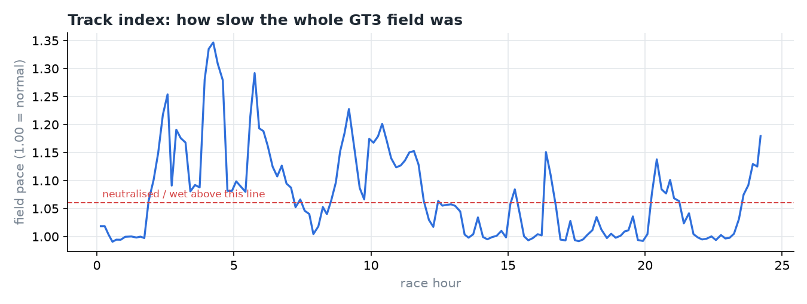
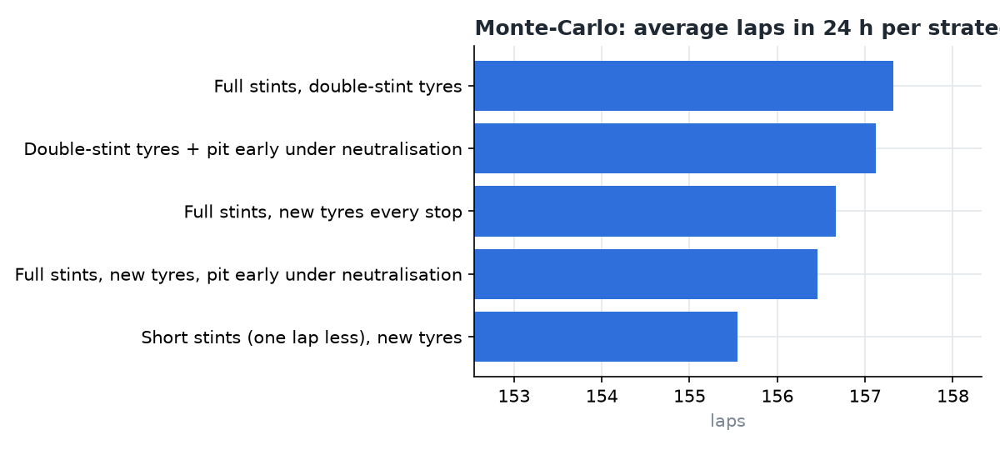
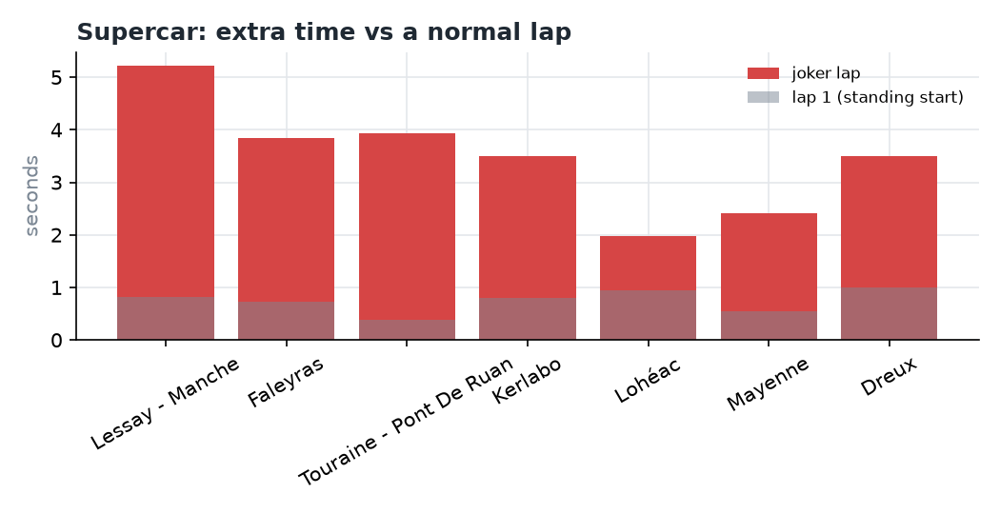
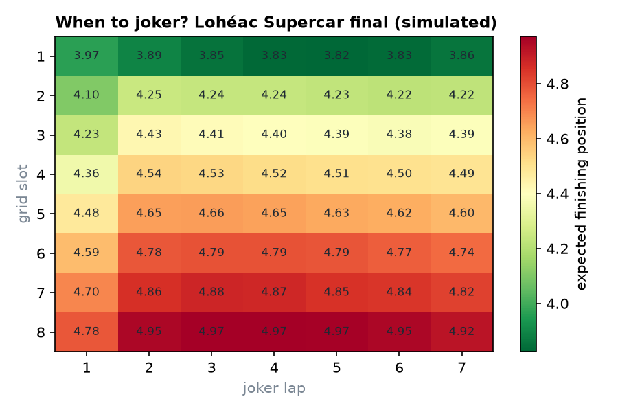

# 🏁 Motorsport Data Lab

**De la data science d'ingénieur de course sur de vraies données de chronométrage : les GT3 aux
24 Heures du Nürburgring (et au Mans), et le Championnat de France de Rallycross.**

[🇬🇧 English version](README.md) · Python 3.11–3.13 · licence MIT ·
IA : **Amazon Chronos-2** et **AutoGluon** (outils open source d'AWS)

---

## En 30 secondes

| Quoi | D'où ça vient | Ce que ça donne |
|---|---|---|
| **4 445 tours de 43 GT3**, 24h du Nürburgring 2026 | PDF officiels ADAC / wige | relais, arrêts, conditions de piste, rythme par modèle, pilotes vs coéquipiers |
| **6 196 lignes de tours sur 7 meetings**, Championnat de France de Rallycross 2026 (Supercar + Super 1600) | résultats officiels ITS Chrono / FFSA | coût du joker par circuit, quand les pilotes le prennent, simulateur de stratégie joker |
| **Simulateur de stratégie** (Monte-Carlo, 24 h) | calibré sur la vraie course | prédit 157 tours ; la GT3 gagnante en a fait 156 |
| **Prévision IA** : Chronos-2 et AutoGluon contre les références d'ingénieur | backtest glissant | un résultat honnête, avec intervalles de confiance |
| **Appli Streamlit bilingue** (FR/EN) | `app/streamlit_app.py` | tous les graphiques, en interactif |

Aucune donnée n'est inventée : tout vient des documents publics des chronométreurs officiels,
téléchargés et lus par le code de `src/motorsport_lab/sources/`.

---

## Le vocabulaire, simplement

| Mot | Sens |
|---|---|
| **GT3** | Voitures de course dérivées de la série (Porsche 911 GT3 R, BMW M4 GT3, Mercedes-AMG GT3…). Au Nürburgring elles courent en classe **SP 9**, au Mans en **LMGT3**. |
| **Temps au tour** | Le temps d'un tour. Tracé des 24h du Nürburgring = 25,4 km, soit environ **8 min 20 s**. |
| **Relais (stint)** | Les tours entre deux arrêts au stand. Au Nürburgring une GT3 fait **8 tours** par relais (limite d'essence). |
| **In-lap / out-lap** | Le tour qui rentre au stand, et celui qui en sort (arrêt compris). |
| **Code 60 / FCY** | Après un incident, des zones ou toute la piste sont limitées à 60 km/h. |
| **Indice de piste** | Notre mesure de la lenteur de tout le plateau à un instant donné (1,00 = normal, 1,20 = 20 % plus lent) : Code 60, pluie, brouillard, nuit. |
| **Joker lap** | Rallycross : un tracé alternatif plus long que chaque pilote doit prendre **une seule fois** par course. *Quand* le prendre, c'est de la stratégie. |
| **Monte-Carlo** | Simuler des milliers de courses aléatoires et regarder la moyenne et la dispersion des résultats. |
| **MAE** | Erreur absolue moyenne : la taille moyenne d'une erreur de prévision, en secondes. Plus bas = mieux. |
| **Référence (baseline)** | La règle simple qu'utiliserait un ingénieur (ex. « prochain tour = dernier tour propre »). Un modèle d'IA n'est utile que s'il fait mieux. |

---

## Résultats clés

### 1. 24h du Nürburgring 2026, GT3 uniquement



* **48 % de la course a été neutralisée ou mouillée** (indice de piste au-dessus de 1,06) : zones
  Code 60, brouillard, pluie. C'est pour ça que les temps bruts trompent, et que chaque comparaison
  est ici corrigée par l'indice de piste.
* **Arrêts au stand** : 591 arrêts ; un arrêt normal coûte **≈ 250 s** (in-lap + out-lap par rapport
  au rythme normal), et **24 s de plus** avec un changement de pilote (232 s → 256 s).
* **Modèles de voitures** (20 % meilleurs tours propres, corrigés des conditions) : la Lamborghini
  Huracán GT3 EVO2 est la plus rapide, puis Ford Mustang, Mercedes-AMG, Aston Martin et BMW à
  5–7 s au tour ([tableau](reports/n24/car_model_pace.csv)). C'est une lecture de la *balance de
  performance* (BoP), pas un jugement sur les voitures.
* **Les chronos seuls ne permettent pas d'isoler la dégradation des pneus au Nürburgring.** La pente
  intra-relais de chaque modèle a un intervalle à 95 % qui contient zéro (ex. Porsche : +0,16 s/tour,
  [−0,17 ; +0,50]). Avec plus de 140 voitures sur 25 km, le trafic pèse plus que l'usure. Une équipe
  ajouterait les données pneus et la télémétrie. On affiche la limite plutôt qu'un faux chiffre.



* **Simulateur de stratégie** calibré sur la vraie course (tour vert 8:20, relais de 8 tours, perte
  au stand, part de neutralisation) : il prédit **157 tours** pour une GT3 de tête ; la gagnante de la
  classe en a fait **156**. Sur les mêmes 3 000 courses simulées, **doubler les relais avec les mêmes
  pneus** est le meilleur plan dans 89 % des cas (+0,7 tour en moyenne), *si* l'usure vaut environ
  0,08 s par tour d'âge du pneu. Ce chiffre est une hypothèse, c'est donc un curseur dans l'appli.

### 2. Championnat de France de Rallycross 2026



* **Le joker coûte 2,0 s à Lohéac mais 5,2 s à Lessay** (Supercar, médiane par pilote face à ses
  propres tours normaux). Toute stratégie doit dépendre du circuit.
* Les pilotes prennent le joker **au 1er tour dans environ 25 %** des manches et des finales (15 % en
  demi-finale) et **au dernier tour dans 15–30 %** des cas. Les autres le prennent en milieu de course
  ([tableau](reports/rx_france/joker_timing.csv)).
* **Simulateur de joker** (finale Supercar de Lohéac, 8 voitures, 7 tours, chiffres de l'épreuve
  réelle) :



  Pour un pilote au rythme moyen : **en pole, prendre le joker tard** (tours 4–6) ; **depuis toute
  autre place, le prendre au 1er tour** pour éviter le trafic du premier virage. Les règles de trafic
  (de combien il faut être plus rapide pour doubler) sont des hypothèses modifiables dans l'appli.

### 3. IA : Chronos-2 et AutoGluon contre l'ingénieur de course

**Question :** *quels temps au tour chaque GT3 va-t-elle faire jusqu'à son prochain arrêt
(8 tours ≈ 70 min) ?* Cinq instants de coupure pendant la course (h4, h8, h12, h16, h20), 142 blocs
voiture × coupure, 1 136 tours prévus. Les modèles savent à l'avance quels tours futurs sont des
tours de stand (une équipe planifie ses arrêts).

| Modèle | MAE, tous les tours | MAE, tours propres | MAE, tours de stand |
|---|---|---|---|
| **Chronos-2** (zero-shot, avec covariables) | **43,0 s** | 20,4 s | 62,3 s |
| Référence : dernier tour propre + perte au stand type | 46,0 s | **12,5 s** | **40,1 s** |
| Référence : médiane des 5 derniers tours propres + perte au stand | 46,0 s | 12,5 s | 40,8 s |
| AutoGluon-TimeSeries (preset rapide, ensemble) | 54,6 s | 37,4 s | 67,1 s |

L'avance de Chronos-2 est-elle réelle ? Un **bootstrap apparié par blocs** (on rééchantillonne des
blocs voiture × coupure) donne un écart de **−3,0 s, intervalle à 95 % [−6,5 ; +0,5]** : **pas
significatif**. Sur les tours propres, Chronos-2 est **significativement moins bon** (+7,9 s,
[+4,3 ; +12,2]). AutoGluon est significativement moins bon partout. **Conclusion :** en endurance 24h,
l'incertitude principale vient des neutralisations, qu'aucun historique de tours ne peut prévoir. Une
règle simple construite avec la connaissance du métier reste la référence pour le rythme en piste
verte. Le modèle de fondation n'aide qu'en « couvrant » vers des tours plus lents.

**Modèle du prochain tour (AutoGluon-Tabular).** Entraînement sur les heures 0–16, test sur 16–24 :

| Modèle | MAE, tous les tours en course | MAE, tours propres |
|---|---|---|
| **AutoGluon-Tabular** | **33,6 s** | **10,4 s** |
| Régression linéaire | 38,5 s | 17,2 s |
| Référence : même temps que le tour précédent | 43,5 s | 10,7 s |

AutoGluon réduit l'erreur de **23 %**. Les entrées les plus utiles sont le tour précédent, l'indice
de piste des 10 dernières minutes, puis le modèle de voiture ([importance](reports/ml/tabular_importance.csv)).

Limites, dites clairement : une seule course ; tours plafonnés à 2× la référence de la voiture (un
tour de drapeau rouge de plusieurs heures ne se prévoit pas) ; le repère « tour propre » est calculé
sur toute la course, ce qui avantage un peu les références.

---

## Lancer le projet

```powershell
git clone https://github.com/DARKQUAD/motorsport-data-lab.git
cd motorsport-data-lab
python -m venv .venv
.venv\Scripts\python -m pip install -e ".[app]"
.venv\Scripts\python -m streamlit run app/streamlit_app.py
```

Les jeux de données traités sont dans `data/`, l'appli marche donc tout de suite. Pour tout
reconstruire depuis les documents officiels, ou relancer les expériences d'IA :

```powershell
.venv\Scripts\mlab data n24 --year 2026      # télécharge + lit les PDF ADAC / wige
.venv\Scripts\mlab data rx --year 2026       # télécharge + lit les résultats ITS Chrono
.venv\Scripts\mlab report n24                # tableaux + figures dans reports/n24
.venv\Scripts\mlab report rx                 # tableaux + figures dans reports/rx_france
.venv\Scripts\python -m pip install -e ".[ml]"   # Chronos-2, AutoGluon, PyTorch (le CPU suffit)
.venv\Scripts\mlab ml forecast               # ~10 min sur un CPU de portable
.venv\Scripts\mlab ml tabular                # ~3 min
```

Le Mans : le site de chronométrage FIA WEC (Al Kamel Systems) liste un `23_Analysis_Race*.CSV` par
séance mais ne le sert plus à une adresse publique. Télécharge-le toi-même (saison → LE MANS → FIA WEC
→ Race → Analysis), puis dépose-le dans la page *Le Mans* de l'appli. Seules les GT3 (LMGT3) sont
gardées.

Porte qualité (aussi lancée par la CI) : `ruff`, `ruff format`, `mypy --strict`, `bandit`, `pylint`
(10/10), `pytest` avec des contrôles sur les vraies données (tours lus = tours du classement officiel,
temps de manche = somme des tours + départ, tours de joker plus lents).

---

## Comment c'est construit

```
src/motorsport_lab/
  sources/       documents officiels -> une table de tours
    n24_wige.py        24h Nürburgring : tour par tour + classement par classe (PDF, wige)
    its_rallycross.py  rallycross France : API publique ITS Chrono + PDF de manche (tours, joker)
    alkamel.py         FIA WEC / Le Mans : CSV Analysis (Al Kamel)
  endurance/     relais, arrêts, indice de piste, écarts pilotes, stratégie Monte-Carlo
  rallycross/    coût du joker, coût du 1er tour, moment du joker, simulateur Monte-Carlo
  ml/            backtest Chronos-2 + AutoGluon-TimeSeries, modèle AutoGluon-Tabular
  reports.py     CSV + PNG ; cli.py : la commande `mlab` ; i18n.py : textes FR/EN
app/streamlit_app.py   tableau de bord bilingue
data/   données réelles traitées (CSV)      reports/   résultats ci-dessus
```

Choix de conception : une **table de tours** simple, commune à toutes les sources. Des
**statistiques robustes** (médianes, quantiles, bootstrap par blocs). Chaque modèle est comparé à une
**référence** qu'un ingénieur utiliserait vraiment. Les **paramètres non mesurables** avec les chronos
(usure des pneus, difficulté de dépassement) sont des curseurs plutôt que des valeurs cachées.

---

## Ce qu'utilisent vraiment les équipes (et le lien avec ce projet)

D'après des offres d'emploi, des CV d'ingénieurs et des prestataires (sources ci-dessous) :

| Besoin | Outils en GT3 / endurance / rallycross | Dans ce repo |
|---|---|---|
| Acquisition et analyse des données voiture | **Bosch WinDarab** (ECU des GT3 Porsche, BMW, Audi), **MoTeC i2**, **Pi Toolbox (Cosworth)**, **AiM Race Studio**, Magneti Marelli, Life Racing | non public ; voir la feuille de route (import télémétrie) |
| Réglage ECU / CAN | Bosch RaceCon, mapping des signaux CAN | — |
| Chronométrage | Al Kamel (FIA WEC, Le Mans), wige (Nürburgring), ITS Chrono / All Tracks Timing (rallycross France) | ✅ un lecteur pour chacun |
| Analyse et outils | **Python** et **MATLAB**, Excel, outils de stratégie maison | ✅ Python, pandas, NumPy, scikit-learn |
| Stratégie | simulation Monte-Carlo de course, fenêtres d'arrêt, scénarios de neutralisation (safety car) | ✅ simulateurs endurance + joker |
| Prévision / ML | usage croissant du ML ; les modèles de fondation pour séries temporelles sont récents | ✅ Chronos-2, AutoGluon, backtest honnête |

En rallycross, le travail est court et intense (courses de 4 à 7 tours). La data porte sur le départ
et le premier virage, le choix du joker et les réglages entre les manches, avec des enregistreurs AiM
/ MoTeC / Life Racing. En endurance, elle porte sur les relais, les arrêts, la répartition des
pilotes, la BoP et les neutralisations, avec WinDarab / MoTeC / Pi Toolbox et le live timing.

Sources : [annonce GoToTheGrid race/data engineer](https://www.gotothegrid.com/en/ads/freelance-jobs-internships/engineer/6007-race-data-engineer-available-2026)
(WinDarab, MoTeC i2, RaceCon, AiM RS3, Pi Toolbox, CAN) ·
[RaceStaff, data & systems engineer GT3/GT4](https://www.racestaff.com/job/data-systems-engineer-5332) ·
[Pratt Miller, data & electronics engineer](https://jobright.ai/jobs/info/6a83ee7ee021cc586fb69059)
(WinDarab, MoTeC, Python) ·
[JB Data Engineering](https://www.jbdataengineering.co.uk/on-track-services) (prestations data en
British GT et au Mans : Pi Toolbox, AiM, MoTeC, Magneti Marelli, Life Racing, Bosch WinDarab) ·
[OptimumG, testing engineer](https://students.optimumg.com/careers/testing-engineer/) (Python / MATLAB) ·
[Stellantis : le rallycross expliqué](https://www.media.stellantis.com/em-en/peugeot-sport/press/rallycross-explained) ·
[article Chronos-2](https://arxiv.org/abs/2510.15821).

## Inspirations

* **Les projets open data F1** (FastF1, TracingInsights) ont montré jusqu'où vont les données
  publiques au tour. Ce repo transpose ces idées à l'endurance et au rallycross, où les
  neutralisations, les changements de pilote et le joker changent les calculs.
* **[MotorsportDB](https://cdn.jsdelivr.net/gh/tobi/imsa_data@main/README.md)** (tours IMSA/WEC dans
  DuckDB) : une seule table `laps` propre pour toutes les séries. C'est notre table de tours commune.
* **Projets Toyota GR Cup « Hack the Track »**
  ([1](https://github.com/ngstephen1/DataScienceHackbyToyota), [2](https://github.com/Novapool/hack_the_track)) :
  dégradation par relais et fenêtres d'arrêt Monte-Carlo. Ici, c'est calibré sur une vraie course de
  24 h, avec des intervalles.
* Projet compagnon : [GT3-Telemetry-Analyzer](https://github.com/DARKQUAD/GT3-Telemetry-Analyzer)
  (analyse de télémétrie : accélérateur, frein, forces G, détection d'anomalies).

## Feuille de route

* Importer les exports CSV MoTeC / WinDarab et la télémétrie de simulation (mémoire partagée d'ACC,
  GT3 sur la Nordschleife) pour mesurer directement l'usure des pneus.
* Plus de données GT3 : courses NLS (Nürburgring Langstrecken-Serie), 24h de Spa, Le Mans 2024–2026.
* Déployer Chronos-2 sur Amazon SageMaker pour des prévisions en direct pendant une course.
* World RX, spéciales de rallye (WRC) et courses de camions (ETRC), avec la même table de tours.

## Données et licence

Code : MIT. Les données de `data/` viennent des documents publics officiels d'**ADAC Nordrhein / wige
SOLUTIONS** (24h-rennen.de) et d'**ITS Chrono / FFSA** (its-results.com, rallycrossfrance.com). Ils
restent la source de référence : vérifie-les avant tout usage officiel. Les noms des pilotes
apparaissent tels que publiés dans les classements officiels.

---

**Auteur :** Romain Dupuy--Martrenchard, étudiant en Master Data & IA (Ynov Bordeaux), en recherche
d'alternance en data science / IA, en particulier dans des équipes **GT3 endurance** et **rallycross**.
[romaindupuy.com](https://romaindupuy.com)
