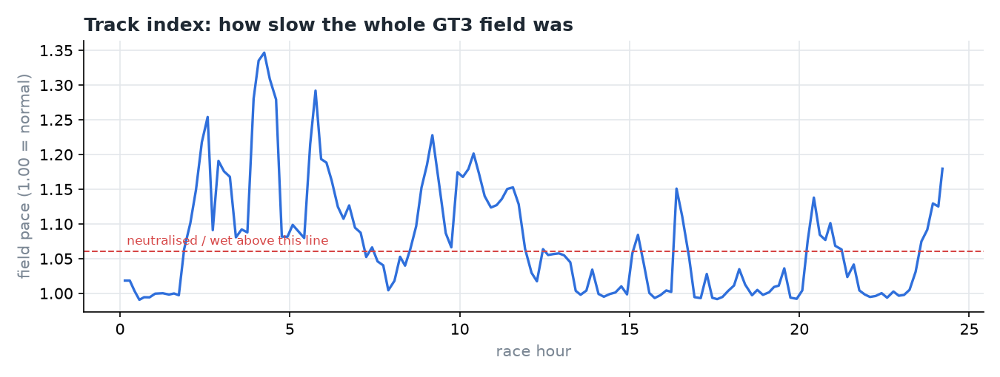
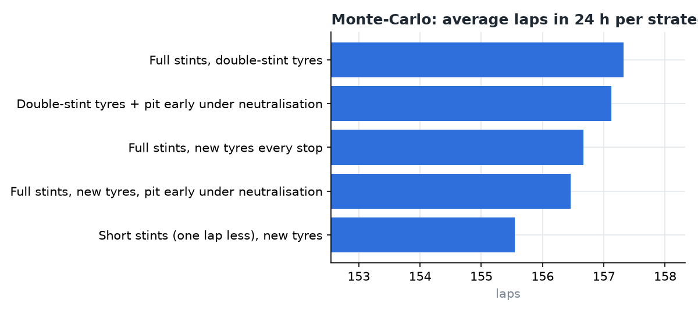
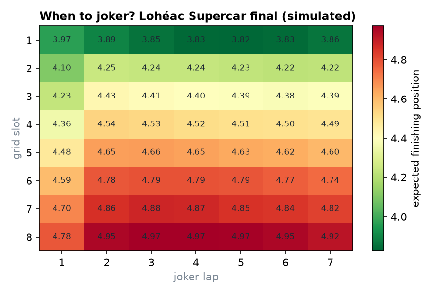

# 🏁 Motorsport Data Lab

**Race-engineering data science on real timing data: GT3 cars at the Nürburgring 24 Hours
(and Le Mans), plus the French Rallycross Championship.**

[🇫🇷 Version française](README.fr.md) · Python 3.11–3.13 · MIT licence ·
AI: **Amazon Chronos-2** and **AutoGluon** (open-source tools from AWS)


---

## In 30 seconds

| What | Where it comes from | What you get |
|---|---|---|
| **4,445 laps of 43 GT3 cars**, 24h Nürburgring 2026 | official ADAC / wige PDFs | stints, pit stops, track conditions, car-model pace, drivers vs team-mates |
| **6,196 lap records of 7 rounds**, French Rallycross 2026 (Supercar + Super 1600) | official ITS Chrono / FFSA results | cost of the joker lap per track, when drivers take it, a joker-strategy simulator |
| **Pit-strategy simulator** (Monte-Carlo, 24 h) | calibrated on the real race | predicts 157 laps; the real GT3 winner did 156 |
| **AI forecasting**: Chronos-2 and AutoGluon vs race-engineer baselines | rolling backtest | an honest result, with confidence intervals |
| **Bilingual Streamlit app** (FR/EN) | `app/streamlit_app.py` | every chart, interactive |

No data is invented: everything comes from the public documents of the official timekeepers.
The data is downloaded and parsed by the code in `src/motorsport_lab/sources/`.

---

## The vocabulary, made simple

| Word | Meaning |
|---|---|
| **GT3** | Race cars derived from road cars (Porsche 911 GT3 R, BMW M4 GT3, Mercedes-AMG GT3…). At the Nürburgring they race in class **SP 9**, at Le Mans in **LMGT3**. |
| **Lap time** | Time for one lap. Nürburgring 24h layout = 25.4 km, so about **8 min 20 s**. |
| **Stint** | The laps between two pit stops. At the Nürburgring a GT3 does **8 laps** per stint (fuel-limited). |
| **In-lap / out-lap** | The lap that ends in the pits, and the lap that leaves them (it includes the stop). |
| **Code 60 / FCY** | After an incident, zones or the whole track are limited to 60 km/h. |
| **Track index** | Our measure of how slow the whole field is at a given moment (1.00 = normal, 1.20 = 20 % slower): Code 60, rain, fog, night. |
| **Joker lap** | Rallycross: a longer alternative route every driver must take **exactly once** per race. *When* to take it is strategy. |
| **Monte-Carlo** | Simulate thousands of random races and look at the average and the spread of the results. |
| **MAE** | Mean absolute error: the average size of a forecast miss, in seconds. Lower is better. |
| **Baseline** | The simple rule a race engineer would use (e.g. "next lap = last clean lap"). An AI model is only useful if it beats it. |

---

## Key results

### 1. Nürburgring 24h 2026, GT3 only



* **48 % of the race was neutralised or wet** (track index above 1.06): Code 60 zones, fog and
  rain. This is why lap times alone mislead, and why every comparison here is corrected by the
  track index.
* **Pit stops**: 591 stops; a routine stop costs **≈ 250 s** (in-lap + out-lap vs. normal pace),
  and **+24 s** more when drivers swap (232 s → 256 s).
* **Car models** (best 20 % of clean laps, corrected for conditions): the Lamborghini Huracán GT3
  EVO2 is fastest, then Ford Mustang, Mercedes-AMG, Aston Martin and BMW 5–7 s per lap behind
  ([table](reports/n24/car_model_pace.csv)). This is a *balance of performance* lens, not a verdict
  on the cars.
* **Tyre degradation cannot be isolated from timing data alone at the Nürburgring.** The
  within-stint slope of every car model has a 95 % interval crossing zero (e.g. Porsche: +0.16 s/lap,
  [−0.17; +0.50]). With 140+ cars on 25 km, traffic noise is larger than tyre wear. A team would add
  tyre data and telemetry; we report the limit instead of a fake number.



* **Strategy simulator**, calibrated on the real race (green lap 8:20, 8-lap stints, stop loss,
  neutralisation share): it predicts **157 laps** for a front-running GT3; the real class winner did
  **156**. On the same 3,000 simulated races, **double-stinting tyres** is the best plan in 89 % of
  them (+0.7 lap on average), *if* tyre wear is about 0.08 s per lap of tyre age. That figure is an
  assumption, so it is a slider in the app.

### 2. French Rallycross Championship 2026


* **The joker lap costs 2.0 s at Lohéac but 5.2 s at Lessay** (Supercar, median per driver vs their
  own normal laps). Any strategy has to be track-specific.
* Drivers take the joker on **lap 1 in about 25 %** of heats and finals (15 % in semi-finals) and on
  the **last lap in 15–30 %**. The rest take it mid-race ([table](reports/rx_france/joker_timing.csv)).
* **Joker simulator** (Lohéac Supercar final, 8 cars, 7 laps, numbers from the real event):



  For an average-pace driver, **from the pole, take the joker late** (lap 4–6); **from any other
  grid slot, take it on lap 1** to avoid the first-corner traffic. The traffic rules (how much faster
  you must be to pass) are assumptions you can change in the app.

### 3. AI: Chronos-2 and AutoGluon vs the race engineer

**Question:** *what lap times will each GT3 do until its next stop (8 laps ≈ 70 min)?*
Five cut-offs during the race (h4, h8, h12, h16, h20), 142 car-and-cut-off blocks, 1,136 laps
forecast. The models know in advance which future laps are pit laps (a team plans its stops).

| Model | MAE, all laps | MAE, clean laps | MAE, pit laps |
|---|---|---|---|
| **Chronos-2** (zero-shot, with covariates) | **43.0 s** | 20.4 s | 62.3 s |
| Baseline: last clean lap + typical pit loss | 46.0 s | **12.5 s** | **40.1 s** |
| Baseline: median of 5 clean laps + pit loss | 46.0 s | 12.5 s | 40.8 s |
| AutoGluon-TimeSeries (fast preset, ensemble) | 54.6 s | 37.4 s | 67.1 s |

Is Chronos-2's lead real? A **paired block bootstrap** (resampling car × cut-off blocks) gives a
difference of **−3.0 s, 95 % interval [−6.5; +0.5]**: **not significant**. On clean laps,
Chronos-2 is **significantly worse** (+7.9 s, [+4.3; +12.2]). AutoGluon is significantly worse
everywhere. **Conclusion:** on 24h endurance data the main uncertainty is neutralisations, which no
lap history can foresee. A simple rule built with domain knowledge stays the reference for green
pace. The foundation model only helps by hedging towards slower laps.

**Next-lap model (AutoGluon-Tabular).** Train on hours 0–16, test on hours 16–24:

| Model | MAE, all racing laps | MAE, clean laps |
|---|---|---|
| **AutoGluon-Tabular** | **33.6 s** | **10.4 s** |
| Linear regression | 38.5 s | 17.2 s |
| Baseline: same as previous lap | 43.5 s | 10.7 s |

AutoGluon improves the error by **23 %** overall. The most useful inputs are the previous lap,
the track index of the previous 10 minutes, then the car model
([importance](reports/ml/tabular_importance.csv)).

Limits, stated plainly: one race, laps capped at 2× the car's reference (red-flag laps of several
hours cannot be forecast), and the "clean lap" flag is computed on the whole race, which slightly
favours the baselines.

---

## Run it

```powershell
git clone https://github.com/DARKQUAD/motorsport-data-lab.git
cd motorsport-data-lab
python -m venv .venv
.venv\Scripts\python -m pip install -e ".[app]"
.venv\Scripts\python -m streamlit run app/streamlit_app.py
```

The processed datasets are in `data/`, so the app works straight away. To rebuild everything from the
official documents, or to rerun the AI experiments:

```powershell
.venv\Scripts\mlab data n24 --year 2026      # download + parse the ADAC / wige PDFs
.venv\Scripts\mlab data rx --year 2026       # download + parse the ITS Chrono results
.venv\Scripts\mlab report n24                # tables + figures in reports/n24
.venv\Scripts\mlab report rx                 # tables + figures in reports/rx_france
.venv\Scripts\python -m pip install -e ".[ml]"   # Chronos-2, AutoGluon, PyTorch (CPU is fine)
.venv\Scripts\mlab ml forecast               # ~10 min on a laptop CPU
.venv\Scripts\mlab ml tabular                # ~3 min
```

Le Mans: the FIA WEC timing site (Al Kamel Systems) lists one `23_Analysis_Race*.CSV` per session
but no longer serves it at a public URL. Download it yourself (season → LE MANS → FIA WEC → Race →
Analysis), then drop it in the app's *Le Mans* page. Only GT3 (LMGT3) is kept.

Quality gate (also run by the CI): `ruff`, `ruff format`, `mypy --strict`, `bandit`, `pylint`
(10/10), `pytest` with checks on the real datasets (laps parsed = laps in the official
classification, heat time = sum of laps + start, joker laps are slower).

---

## How it is built

```
src/motorsport_lab/
  sources/       official documents -> one lap table
    n24_wige.py        24h Nürburgring lap-by-lap + class results (PDF, wige)
    its_rallycross.py  French rallycross: public ITS Chrono API + heat PDFs (laps, joker splits)
    alkamel.py         FIA WEC / Le Mans Analysis CSV (Al Kamel)
  endurance/     stints, pit stops, track index, driver deltas, Monte-Carlo pit strategy
  rallycross/    joker cost, lap-1 cost, joker timing, Monte-Carlo joker simulator
  ml/            Chronos-2 + AutoGluon-TimeSeries backtest, AutoGluon-Tabular lap model
  reports.py     CSV + PNG; cli.py: the `mlab` command; i18n.py: FR/EN texts
app/streamlit_app.py   bilingual dashboard
data/   processed real data (CSV)      reports/   results shown above
```

Design choices: one simple **lap table** shared by every source. **Robust statistics** (medians,
quantiles, block bootstrap). Every model is compared with a **baseline** a race engineer would
actually use. **Parameters that cannot be measured** from timing data (tyre wear, overtaking
difficulty) are exposed as sliders instead of being hidden.

---

## What teams actually use (and how this project maps to it)

From public job ads, engineer CVs and suppliers (sources below):

| Need | Tools in GT3 / endurance / rallycross teams | In this repo |
|---|---|---|
| Car data logging & analysis | **Bosch WinDarab** (Porsche, BMW, Audi GT3 ECUs), **MoTeC i2**, **Pi Toolbox (Cosworth)**, **AiM Race Studio**, Magneti Marelli, Life Racing | not public; see roadmap (telemetry import) |
| ECU / CAN set-up | Bosch RaceCon, CAN signal mapping | — |
| Timing & scoring | Al Kamel (FIA WEC, Le Mans), wige (Nürburgring), ITS Chrono / All Tracks Timing (French rallycross) | ✅ parsers for all three |
| Analysis & tools | **Python** and **MATLAB**, Excel, custom strategy tools | ✅ Python, pandas, NumPy, scikit-learn |
| Strategy | Monte-Carlo race simulation, pit-window and neutralisation ("safety car") scenarios | ✅ endurance + joker simulators |
| Forecasting / ML | growing use of ML; time-series foundation models are new | ✅ Chronos-2, AutoGluon, honest backtest |

Rallycross work is short and intense (4–7-lap races). Data work is about launch and the first
corner, the joker decision, and set-up between heats, with AiM / MoTeC / Life Racing loggers.
Endurance work is about stints, pit stops, driver line-ups, balance of performance and neutralisations,
with WinDarab / MoTeC / Pi Toolbox, plus live timing feeds.

Sources: [GoToTheGrid race/data engineer ad](https://www.gotothegrid.com/en/ads/freelance-jobs-internships/engineer/6007-race-data-engineer-available-2026)
(WinDarab, MoTeC i2, RaceCon, AiM RS3, Pi Toolbox, CAN) ·
[RaceStaff, GT3/GT4 data & systems engineer](https://www.racestaff.com/job/data-systems-engineer-5332) ·
[Pratt Miller data & electronics engineer](https://jobright.ai/jobs/info/6a83ee7ee021cc586fb69059)
(WinDarab, MoTeC, Python) ·
[JB Data Engineering](https://www.jbdataengineering.co.uk/on-track-services) (British GT and Le Mans
data services: Pi Toolbox, AiM, MoTeC, Magneti Marelli, Life Racing, Bosch WinDarab) ·
[OptimumG testing engineer](https://students.optimumg.com/careers/testing-engineer/) (Python / MATLAB) ·
[Stellantis: rallycross explained](https://www.media.stellantis.com/em-en/peugeot-sport/press/rallycross-explained) ·
[Chronos-2 paper](https://arxiv.org/abs/2510.15821).

## Inspirations

* **F1 open-data projects** (FastF1, TracingInsights) showed how far lap-level public data can go.
  This repo transfers the ideas to endurance and rallycross, where neutralisations, driver
  swaps and jokers change the maths.
* **[MotorsportDB](https://cdn.jsdelivr.net/gh/tobi/imsa_data@main/README.md)** (IMSA/WEC laps in
  DuckDB): one tidy `laps` table for every series. That is our common lap table.
* **Toyota GR Cup "Hack the Track" projects**
  ([1](https://github.com/ngstephen1/DataScienceHackbyToyota), [2](https://github.com/Novapool/hack_the_track)):
  stint degradation and Monte-Carlo pit windows. Here they are calibrated on a real 24 h race, with
  intervals.
* Companion project: [GT3-Telemetry-Analyzer](https://github.com/DARKQUAD/GT3-Telemetry-Analyzer)
  (telemetry-level analysis: throttle, brake, G-forces, anomaly detection).

## Roadmap

* Import MoTeC / WinDarab CSV exports and sim-racing telemetry (ACC shared memory, GT3 at the
  Nordschleife) to measure tyre wear directly.
* More GT3 data: NLS (Nürburgring Endurance Series) races, Spa 24h, Le Mans 2024–2026.
* Deploy Chronos-2 on Amazon SageMaker for live forecasts during a race.
* World RX, rally stages (WRC) and truck racing (ETRC) with the same lap-table approach.

## Data & licence

Code: MIT. The data in `data/` comes from the official public documents of **ADAC Nordrhein / wige
SOLUTIONS** (24h-rennen.de) and **ITS Chrono / FFSA** (its-results.com, rallycrossfrance.com).
They remain the source of truth; check them before any official use. Driver names appear as published
in the official classifications.

---

**Author:** Romain Dupuy--Martrenchard, MSc Data & AI student (Ynov Bordeaux), looking for a work-study
role in data science / AI, especially with **GT3 endurance** and **rallycross** teams.
[romaindupuy.com](https://romaindupuy.com)
