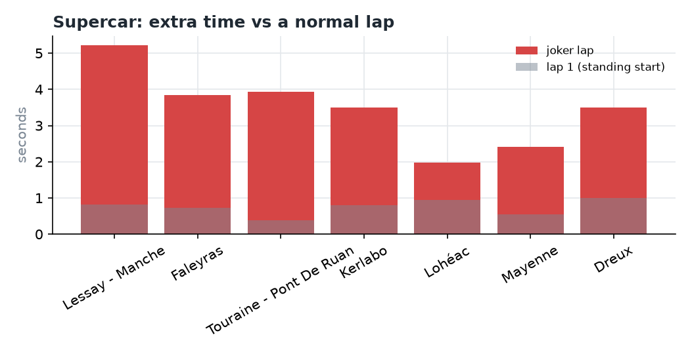
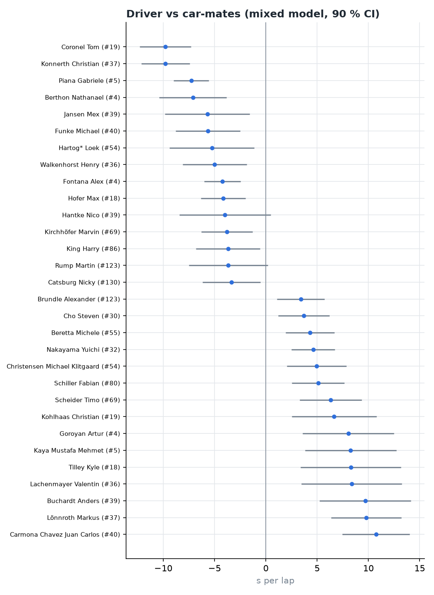
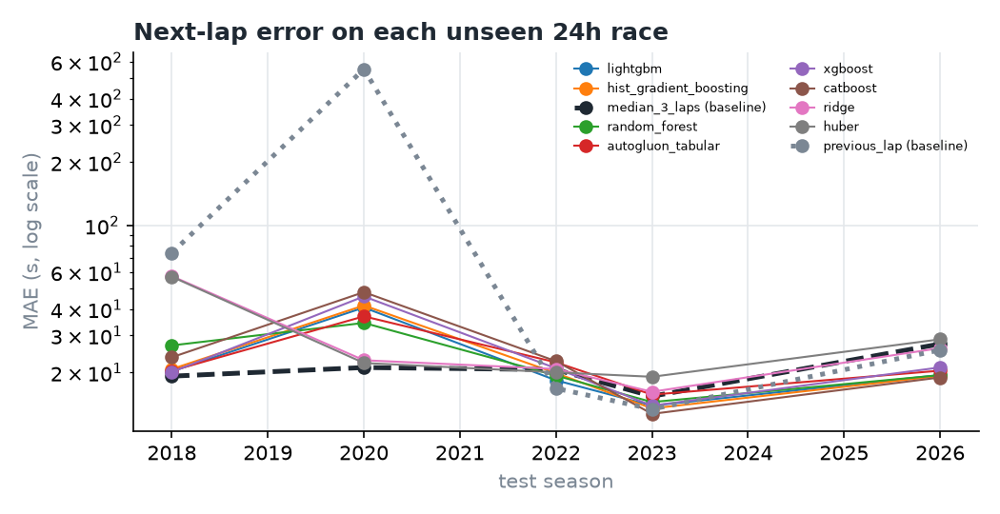
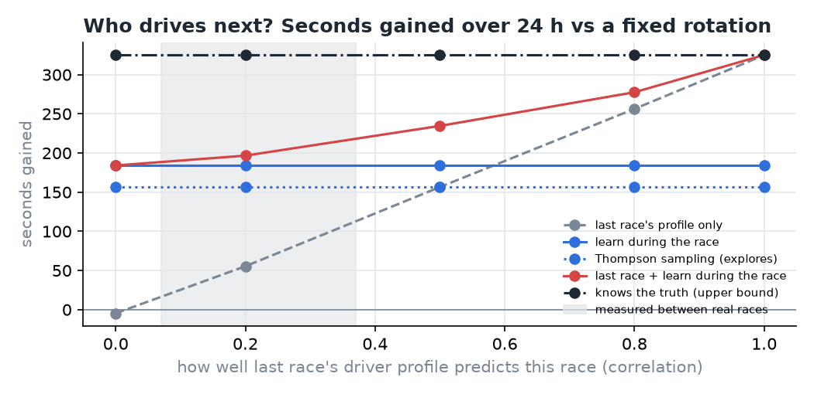

# 🏁 Motorsport Data Lab

**Race-engineering data science on real timing data: GT3 cars at the Nürburgring 24 Hours
(and Le Mans), plus the French Rallycross Championship.**

[🇫🇷 Version française](README.fr.md) · Python 3.11–3.13 · MIT licence ·
ML: **Chronos-2**, **AutoGluon** (AWS), LightGBM, XGBoost, CatBoost, statsforecast, statsmodels, Optuna, SHAP


---

## In 30 seconds

| What | Where it comes from | What you get |
|---|---|---|
| **4,445 laps of 43 GT3 cars**, 24h Nürburgring 2026, **plus 5 earlier editions** (2017–2023, 20,315 GT3 laps in all) for blind tests | official ADAC / wige PDFs | stints, pit stops, track conditions, car-model pace, drivers vs team-mates |
| **6,196 lap records of 7 rounds**, French Rallycross 2026 (Supercar + Super 1600) | official ITS Chrono / FFSA results | cost of the joker lap per track, when drivers take it, a joker-strategy simulator |
| **Pit-strategy simulator** (Monte-Carlo, 24 h) | calibrated on the real race | predicts 157 laps; the real GT3 winner did 156 |
| **Machine learning**: Chronos-2, AutoGluon, gradient boosting, ETS / ARIMA, conformal intervals, SHAP | rolling backtest, time split | an honest result, with confidence intervals |
| **Statistics**: mixed-effects driver ratings, logistic model of rallycross wins | statsmodels | who is fast in their car; what the joker timing is worth |
| **Who drives next?** Driver style from timing data, and a driver-choice agent that learns each driver's pace during the race (Bayesian bandit / RL) | simulator calibrated on the 6 races | +196 s over a fixed rotation; last year's style alone barely helps |
| **Bilingual Streamlit app** (FR/EN) | `app/streamlit_app.py` | every chart, interactive |

No data is invented: everything comes from the public documents of the official timekeepers.
The data is downloaded and parsed by the code in `src/motorsport_lab/sources/`.

---

## Try it without installing anything

[](https://motorsport-data-lab.streamlit.app) [](https://colab.research.google.com/github/DARKQUAD/motorsport-data-lab/blob/main/notebooks/quickstart.ipynb) [](https://codespaces.new/DARKQUAD/motorsport-data-lab?quickstart=1)

| Where | What you get | What you need |
|---|---|---|
| **Google Colab** | a notebook that fetches the repo and runs the main analyses: pace, pit stops, joker cost, model zoo, blind test across seasons, who drives next | a free Google account |
| **GitHub Codespaces** | the whole project in VS Code in the browser; the app starts on its own (port 8501) | a free GitHub account (60 h / month included) |
| **[motorsport-data-lab.streamlit.app](https://motorsport-data-lab.streamlit.app)** | the app itself, live (Streamlit Community Cloud) | nothing, just a browser |

---

## The vocabulary, made simple

| Word | Meaning |
|---|---|
| **GT3** | Race cars derived from road cars (Porsche 911 GT3 R, BMW M4 GT3, Mercedes-AMG GT3…). At the Nürburgring they race in class **SP 9**, at Le Mans in **LMGT3**. |
| **Lap time** | Time for one lap. Nürburgring 24h layout = 25.4 km, so about **8 min 20 s**. |
| **Stint** | The laps between two pit stops. At the Nürburgring a GT3 does **8 laps** per stint (fuel-limited). |
| **In-lap / out-lap** | The lap that ends in the pits, and the lap that leaves them (it includes the stop). |
| **Code 60 / FCY** | After an incident, zones or the whole track are limited to 60 km/h. |
| **Track index** | Our measure of how slow the whole field is at a given moment (1.00 = normal, 1.20 = 20 % slower): Code 60, rain, fog, night. |
| **Joker lap** | Rallycross: a longer alternative route every driver must take **exactly once** per race. *When* to take it is strategy. |
| **Monte-Carlo** | Simulate thousands of random races and look at the average and the spread of the results. |
| **MAE** | Mean absolute error: the average size of a forecast miss, in seconds. Lower is better. |
| **Baseline** | The simple rule a race engineer would use (e.g. "next lap = last clean lap"). An AI model is only useful if it beats it. |

---

## Key results

### 1. Nürburgring 24h 2026, GT3 only


* **48 % of the race was neutralised or wet** (track index above 1.06): Code 60 zones, fog and
  rain. This is why lap times alone mislead, and why every comparison here is corrected by the
  track index.
* **Pit stops**: 591 stops; a routine stop costs **≈ 250 s** (in-lap + out-lap vs. normal pace),
  and **+24 s** more when drivers swap (232 s → 256 s).
* **Car models** (best 20 % of clean laps, corrected for conditions): the Lamborghini Huracán GT3
  EVO2 is fastest, then Ford Mustang, Mercedes-AMG, Aston Martin and BMW 5–7 s per lap behind
  ([table](reports/n24/car_model_pace.csv)). This is a *balance of performance* lens, not a verdict
  on the cars.
* **Tyre degradation cannot be isolated from timing data alone at the Nürburgring.** The
  within-stint slope of every car model has a 95 % interval crossing zero (e.g. Porsche: +0.16 s/lap,
  [−0.17; +0.50]). With 140+ cars on 25 km, traffic noise is larger than tyre wear. A team would add
  tyre data and telemetry; we report the limit instead of a fake number.


* **Strategy simulator**, calibrated on the real race (green lap 8:20, 8-lap stints, stop loss,
  neutralisation share): it predicts **157 laps** for a front-running GT3; the real class winner did
  **156**. On the same 3,000 simulated races, **double-stinting tyres** is the best plan in 89 % of
  them (+0.7 lap on average), *if* tyre wear is about 0.08 s per lap of tyre age. That figure is an
  assumption, so it is a slider in the app.

### 2. French Rallycross Championship 2026



* **The joker lap costs 2.0 s at Lohéac but 5.2 s at Lessay** (Supercar, median per driver vs their
  own normal laps). Any strategy has to be track-specific.
* Drivers take the joker on **lap 1 in about 25 %** of heats and finals (15 % in semi-finals) and on
  the **last lap in 15–30 %**. The rest take it mid-race ([table](reports/rx_france/joker_timing.csv)).
* **Joker simulator** (Lohéac Supercar final, 8 cars, 7 laps, numbers from the real event):


  For an average-pace driver, **from the pole, take the joker late** (lap 4–6); **from any other
  grid slot, take it on lap 1** to avoid the first-corner traffic. The traffic rules (how much faster
  you must be to pass) are assumptions you can change in the app.

### 3. Machine learning and statistics: many tools, one honest yardstick

Every model below is compared with the simple rule a race engineer would use, on data it never
saw, with a **block bootstrap** interval (resampling whole car × time blocks, because laps of the
same car are correlated). An interval that does not cross zero = a real difference.

**3a. Forecast the next stint (8 laps ≈ 70 min).** Five cut-offs during the race (h4 → h20),
142 car-and-cut-off blocks, 1,136 laps forecast. The models know which future laps are pit laps
(a team plans its stops).

| Model | Family | MAE, all laps | MAE, clean laps | MAE, pit laps |
|---|---|---|---|---|
| **Chronos-2** (zero-shot, with covariates) | foundation model (Amazon) | **43.0 s** | 20.4 s | 62.3 s |
| AutoTheta + pit loss | statistics (statsforecast) | 45.1 s | 12.7 s | 40.6 s |
| AutoETS + pit loss | statistics (statsforecast) | 45.3 s | **12.3 s** | **39.8 s** |
| Baseline: last clean lap + typical pit loss | race-engineer rule | 46.0 s | 12.5 s | 40.1 s |
| Baseline: median of 5 clean laps + pit loss | race-engineer rule | 46.0 s | 12.5 s | 40.8 s |
| AutoGluon-TimeSeries (fast preset, ensemble) | AutoML (Amazon) | 54.6 s | 37.4 s | 67.1 s |
| AutoARIMA with pit laps as regressors | statistics | 55.1 s | 39.1 s | 62.0 s |

* Chronos-2 vs the baseline: **−3.0 s, 95 % interval [−6.5; +0.5], not significant**; on clean laps
  it is **significantly worse** (+7.9 s, [+4.3; +12.2]).
* ETS and Theta are **significantly better, but only by 0.7–0.9 s** ([−1.2; −0.1] and [−1.7; −0.1]),
  and not on clean laps. ARIMA and AutoGluon are significantly worse
  ([table](reports/ml/forecast_significance.csv)).
* **Conclusion:** on 24h data the main uncertainty is neutralisations, which no lap history can
  foresee. Fitting the green-flag pace with simple exponential smoothing and adding the known pit
  loss is as good as anything; a big model is not worth it here.

**3b. Predict the next lap: the model zoo.** Same features for everyone (car model, driver slot,
lap in stint, race hour, previous lap, median of the last 3 laps, track index of the previous
10 minutes). Train on hours 0–16, test on hours 16–24 of the 2026 race.


| Model | MAE, all racing laps | MAE, clean laps | vs previous lap, 95 % interval |
|---|---|---|---|
| **LightGBM** (L1 loss) | **31.4 s** | **8.4 s** | −12.1 s [−35.0; −0.4] |
| LightGBM tuned with **Optuna** (40 trials, validation = hours 12–16 only) | 31.4 s | 8.8 s | −12.0 s [−34.9; −0.4] |
| scikit-learn HistGradientBoosting | 31.7 s | 8.4 s | −11.8 s [−34.7; −0.0] |
| CatBoost | 31.9 s | 8.5 s | −11.6 s [−34.5; +0.2] |
| Huber regression (robust linear) | 32.7 s | 10.5 s | −10.7 s [−33.8; +1.2] |
| XGBoost | 32.9 s | 8.4 s | −10.6 s [−33.8; +1.5] |
| AutoGluon-Tabular (medium preset) | 33.6 s | 10.4 s | |
| Ridge regression | 38.6 s | 18.3 s | −4.9 s [−26.5; +6.3] |
| Baseline: median of the last 3 laps | 39.7 s | 13.6 s | −3.8 s [−20.8; +5.0] |
| Random forest | 42.6 s | 11.7 s | −0.9 s [−23.7; +12.8] |
| Baseline: same as previous lap | 43.5 s | 10.7 s | 0 |

* On this race, gradient boosting wins (LightGBM, HistGradientBoosting, CatBoost: within 0.5 s of each other; **over 5 other races this lead disappears, see 3e**),
  **ahead of AutoGluon**, and it is the only family whose lead over the baseline is significant. The
  intervals are wide because a few neutralised laps cost minutes.
* **Optuna tuning did not help** on the test hours: the best settings on hours 12–16 do not transfer
  to the night and morning. Reported as it is.
* **SHAP** (TreeSHAP built into LightGBM): the track index of the previous 10 minutes explains the
  most (19 s on average), then the race hour (15 s) and the previous lap (9 s)
  ([table](reports/ml/classic_shap.csv)).
* **Conformal prediction** (conformalised quantile regression): raw LightGBM 80 % quantile bands
  only contain **27 %** of the real laps of hours 16–24. After calibration on hours 12–16 they contain
  **75 %** (77 % of clean laps) for a target of 80 %. Uncertainty you can nearly trust; the remaining
  gap is the race changing between the calibration and test hours.

**3c. Driver ratings with a mixed-effects model** (statsmodels, REML). Each clean lap, corrected for
the track index = car effect + lap in stint + race hour + **driver effect** (random, shared across
cars) + noise. Drivers with few laps are pulled towards zero, so 6 lucky laps cannot top the table.



* 121 drivers, 1,634 clean laps. The driver-to-driver spread is **4.8 s per lap** against 6.6 s of
  lap-to-lap noise: drivers explain **34 %** of the variance left once the car is known.
* 19 drivers are significantly faster than expected in their car, and 19 significantly slower (90 %
  interval). The ratings agree with the raw team-mate deltas (correlation 0.91) but come with
  honest error bars ([table](reports/ml/driver_ratings.csv)).

**3d. Rallycross: what wins a race?** 85 race or qualifying-round classifications, 1,143 driver
results. Logistic regression (statsmodels, race-clustered errors), at equal pace:

| Joker taken… | Odds of winning vs a mid-race joker | 95 % interval |
|---|---|---|
| on the **last lap** | **× 2.1** | [1.2; 3.7] |
| on **lap 1** | **× 0.27** | [0.09; 0.78] |

Then a cross-validation that holds out **one whole meeting at a time**: the full logistic model
(log loss 0.149, Brier score 0.046, its favourite wins **64 %** of races) beats gradient boosting
(0.153, 56 %) and a pace-only model (0.155, 53 %). With 85 races a simple, interpretable model is
the right choice. This is a **link, not proof of cause**: a leader in clean air can choose to joker
late, while a driver stuck in traffic takes it on lap 1 to escape. That is exactly what the joker
simulator explores.

**3e. Blind test on other years: does any of this hold beyond 2026?** Every result above comes
from one race. Six editions of the Nürburgring 24h have a public lap-by-lap file (2017, 2018,
2020, 2022, 2023, 2026: 20,315 GT3 laps). Each model now **only learns from the races before the
one it is scored on**, like a team preparing next year's race. Red-flag "laps" of several hours
(2020) are left out because no lap history can foresee them.



*Next lap*, trained on all earlier races, scored on 5 unseen races (2018 → 2026):

| Model | MAE, all seasons | vs median of last 3 laps, 95 % interval | Races won |
|---|---|---|---|
| LightGBM | **20.6 s** | −0.4 s [−1.2; +0.3] | 0 of 5 |
| HistGradientBoosting | 21.0 s | −0.1 s [−0.8; +0.7] | 0 |
| **Baseline: median of the last 3 laps** | 21.05 s | reference | **2** |
| Random forest | 21.4 s | +0.4 s [−0.4; +1.1] | 0 |
| AutoGluon-Tabular, medium preset (60 s) | 22.1 s | **+1.1 s** [+0.3; +1.8] | 0 |
| AutoGluon-Tabular, **best_quality** (600 s per race, bagging + stacking) | 22.2 s | **+1.2 s** [+0.4; +1.9] | 0 |
| XGBoost | 22.2 s | **+1.2 s** [+0.4; +1.9] | 0 |
| CatBoost | 22.6 s | **+1.6 s** [+0.8; +2.3] | 2 |
| Ridge / Huber | 28.1 / 29.1 s | **+7 to +8 s** | 0 |
| Baseline: same as previous lap | 91.3 s | **+70 s** (it repeats the 2020 red-flag lap) | 1 |

*Next stint (8 laps)*, rolling backtest on all 6 races, 5,464 laps:

| Model | MAE, all laps | vs last clean lap | MAE, clean laps | vs last clean lap |
|---|---|---|---|---|
| Chronos-2 | **38.6 s** | −1.5 s [−3.1; +0.1], better in 2 races of 6 | 19.8 s | **+6.5 s** [+5.2; +8.0], worse in 6 of 6 |
| Baseline: last clean lap + pit loss | 40.1 s | reference | 13.3 s | reference |
| AutoETS + pit loss | 40.6 s | +0.5 s [0.0; +0.9] | 12.4 s | **−0.9 s** [−1.3; −0.4], better in 5 of 6 |
| Baseline: median of 5 clean laps + pit loss | 41.9 s | +1.8 s [+1.1; +2.5] | **11.9 s** | **−1.4 s** [−2.0; −0.9], better in 6 of 6 |
| AutoGluon-TimeSeries, fast preset | 43.2 s | **+3.1 s** [+1.2; +5.0] | 25.3 s | **+12.0 s**, worse in 6 of 6 |
| AutoGluon-TimeSeries, **best_quality** (120 s per cut-off; includes Chronos-2 fine-tuning and Toto) | 44.3 s | **+4.2 s** [+2.2; +6.2] | 28.4 s | **+15.1 s**, worse in 6 of 6 |
| AutoARIMA with regressors | 43.5 s | **+3.4 s** [+0.9; +6.2] | 26.3 s | **+13.0 s** |

What the other years change:

* **AutoGluon's `best_quality` preset does not help here.** It trains many more models and stacks them, yet it ends up no better than the medium preset on the next lap and worse than the fast preset on the next stint. More model search cannot make up for 6 races of data and neutralisations no lap history can foresee. The time budget (120 s per cut-off for time series) is modest: AutoGluon skipped its Chronos-2 fine-tuning when time ran out, so a much longer run could do better.

* **Two 2026 "wins" do not replicate.** LightGBM's significant lead over the simple rule in 2026
  becomes a tie over 5 races. AutoETS's small but significant lead on all laps becomes a tie too.
  One race is not enough to claim a model is better: this is exactly why the blind test matters.
* **What does replicate:** the gradient-boosting family ties the best simple rule, and nothing
  beats it reliably. Chronos-2 and AutoGluon-TimeSeries are **worse on green-flag laps in every one
  of the 6 races**. On clean laps the best forecast of the next stint is the **median of the last
  5 clean laps**, which wins all 6 races.
* **Conformal intervals** fitted on earlier races and calibrated on the previous one cover 94 %
  (2022), 81 % (2023) and 72 % (2026) of the laps for a target of 80 %, but only **20 % in 2020**:
  a September race in fog and rain looked like no earlier race. Calibrated uncertainty only holds
  when the new race resembles the calibration race.
* **Driver ratings barely carry over from one year to the next.** The Spearman correlation between
  a driver's rating in one edition and the next is 0.27 (2020 → 2022), 0.37 (2022 → 2023) and
  0.07 (2023 → 2026), and the mixed model is no more stable than the raw team-mate delta. Drivers
  change cars and team-mates, and a 24 h race gives each driver only 10–40 clean laps. A team
  would need several races, or telemetry, to rate its drivers.
* **Rallycross, unseen categories.** Previous French seasons are not public lap by lap (ITS Chrono
  only times the championship since 2026), so the blind test uses the 4 categories never used to
  build the models: Division 3, 4, 5 and Féminines (180 races, 2,347 results). The joker effect
  **replicates almost exactly**: last-lap joker × 2.3 [1.5; 3.4], lap-1 joker × 0.27 [0.13; 0.54]
  (development set: × 2.1 and × 0.27). The logistic model trained on Supercar and Super 1600 still
  picks the winner in **61 %** of the unseen races (log loss 0.156 vs 0.271 for no model) and stays
  ahead of gradient boosting (58 %).

**3f. Driver style, and who should drive the next stint?** Can a strategy adapt to each
driver's style? From timing data alone, a driver's style is seen through five traits measured
against their own car and corrected for track conditions: pace, consistency, fade along a stint,
night delta and cold-tyre lap ([profiles](reports/ml/style_profiles_latest.csv)).

* **Between races, none of the five traits carries over.** Spearman correlation of each trait from
  one edition to the next: pace 0.19 / −0.11, consistency 0.03 / 0.14, stint fade 0.23 / −0.11,
  night delta 0.39 / −0.11, cold-tyre lap 0.19 / 0.01 (2022 → 2023 / 2023 → 2026, 16 to 29
  drivers in both races). A driver does 10 to 40 clean laps in a 24 h race, and changes car and
  team-mates from year to year: one race's style is mostly noise. Tailoring a strategy to last
  year's style would be tailoring it to noise.
* **Within one race, pace does carry over.** A driver's pace in the first 12 hours predicts the
  next 12 hours: Spearman 0.54 (2022, 60 drivers), 0.29 (2023, 63), 0.28 (2026, 39).

So the useful thing to learn is the drivers' pace **during the race**. At each stop the team picks
the next driver under the rules (every driver drives at least 4 stints, at most 2 in a row): a
constrained multi-armed bandit, the simplest form of reinforcement learning. The simulator is
calibrated on the measurements above (driver spread 4.0 s, night spread 4.3 s, stint-to-stint form
4.5 s so that the within-race reliability matches the measured ~0.38). 2,000 simulated 24 h races,
3 drivers, gain over a fixed rotation:

| Policy | Time gained | 95 % range | Races better than rotation |
|---|---|---|---|
| Last race's profile only | +52 s | [−571; +632] | 56 % |
| Learn during the race (Bayesian update, greedy) | +183 s | [−282; +697] | 76 % |
| Thompson sampling (explores more) | +151 s | [−287; +622] | 75 % |
| **Last race as a weak prior + learn during the race** | **+196 s (0.4 lap)** | [−278; +715] | **77 %** |
| Knows every driver's true pace (upper bound) | +323 s | [−143; +832] | 91 % |



* Learning during the race captures **60 % of the possible gain**; last year's profile alone, 16 %.
  The extra exploration of Thompson sampling does not pay: the minimum-stint rule already forces
  every driver into the car.
* The chart shows when history would start to pay: only if last race's profile predicted this race
  with a correlation above ~0.5. That is far above anything measured here, which is the case for
  telemetry (braking points, throttle traces), not for lap times.
* What this is not: a validated tool. The gain comes from a simulator built on measured spreads,
  and the true counterfactual (what would have happened with another driver) is never observed.
  You can change the rules in the app or in the notebook.

Limits, stated plainly: laps capped at 2× the car's reference (red-flag laps of
several hours cannot be forecast); the "clean lap" flag is computed on the whole race, which
slightly favours the baselines.

---

## Run it

```powershell
git clone https://github.com/DARKQUAD/motorsport-data-lab.git
cd motorsport-data-lab
python -m venv .venv
.venv\Scripts\python -m pip install -e ".[app]"
.venv\Scripts\python -m streamlit run app/streamlit_app.py
```

The processed datasets are in `data/`, so the app works straight away. To rebuild everything from the
official documents, or to rerun the AI experiments:

```powershell
.venv\Scripts\mlab data n24 --year 2026      # download + parse the ADAC / wige PDFs (also 2017, 2018, 2020, 2022, 2023)
.venv\Scripts\mlab data rx --year 2026 --other-categories   # rallycross blind test set
.venv\Scripts\mlab data rx --year 2026       # download + parse the ITS Chrono results
.venv\Scripts\mlab report n24                # tables + figures in reports/n24
.venv\Scripts\mlab report rx                 # tables + figures in reports/rx_france
.venv\Scripts\python -m pip install -e ".[models]"   # LightGBM, XGBoost, CatBoost, statsforecast, statsmodels, Optuna
.venv\Scripts\mlab ml classic                # model zoo + Optuna + SHAP + conformal (~2 min)
.venv\Scripts\mlab ml ratings                # mixed-effects driver ratings
.venv\Scripts\mlab ml rx-win                 # rallycross win model (+ blind test)
.venv\Scripts\mlab ml style                  # driver style + who drives next
.venv\Scripts\mlab ml seasons --models last_clean_lap,median_5_clean_laps,auto_ets,auto_theta   # blind test on 6 editions
.venv\Scripts\mlab ml forecast               # ETS / Theta / ARIMA backtest (~1 min)
.venv\Scripts\python -m pip install -e ".[ml]"   # Chronos-2, AutoGluon, PyTorch (CPU is fine)
.venv\Scripts\mlab ml forecast --models last_clean_lap,median_5_clean_laps,chronos2,autogluon   # ~10 min
.venv\Scripts\mlab ml tabular                # AutoGluon-Tabular, ~3 min
```

Le Mans: the FIA WEC timing site (Al Kamel Systems) lists one `23_Analysis_Race*.CSV` per session
but no longer serves it at a public URL. Download it yourself (season → LE MANS → FIA WEC → Race →
Analysis), then drop it in the app's *Le Mans* page. Only GT3 (LMGT3) is kept.

Quality gate (also run by the CI): `ruff`, `ruff format`, `mypy --strict`, `bandit`, `pylint`
(10/10), `pytest` with checks on the real datasets (laps parsed = laps in the official
classification, heat time = sum of laps + start, joker laps are slower).

---

## How it is built

```
src/motorsport_lab/
  sources/       official documents -> one lap table
    n24_wige.py        24h Nürburgring lap-by-lap + class results (PDF, wige)
    its_rallycross.py  French rallycross: public ITS Chrono API + heat PDFs (laps, joker splits)
    alkamel.py         FIA WEC / Le Mans Analysis CSV (Al Kamel)
  endurance/     stints, pit stops, track index, driver deltas, Monte-Carlo pit strategy,
                 ratings.py: mixed-effects driver ratings; driver_style.py: style
                 traits and their stability; lineup.py: who drives next (bandit / RL)
  rallycross/    joker cost, lap-1 cost, joker timing, Monte-Carlo joker simulator,
                 models.py: logistic + gradient-boosting win model
  ml/            forecasting.py: Chronos-2, AutoGluon-TimeSeries, ETS / Theta / ARIMA
                 classic.py: ridge, Huber, random forest, LightGBM, XGBoost, CatBoost,
                 Optuna, SHAP, conformal intervals; tabular.py: AutoGluon-Tabular
                 seasons.py: blind tests across the 6 editions (forward chaining)
  reports.py     CSV + PNG; cli.py: the `mlab` command; i18n.py: FR/EN texts
app/streamlit_app.py   bilingual dashboard (streamlit_app.py at the root: cloud entry)
notebooks/quickstart.ipynb   Colab notebook     .devcontainer/   GitHub Codespaces
data/   processed real data (CSV)      reports/   results shown above
```

Design choices: one simple **lap table** shared by every source. **Robust statistics** (medians,
quantiles, block bootstrap). Every model is compared with a **baseline** a race engineer would
actually use. **Parameters that cannot be measured** from timing data (tyre wear, overtaking
difficulty) are exposed as sliders instead of being hidden.

---

## What teams actually use (and how this project maps to it)

From public job ads, engineer CVs and suppliers (sources below):

| Need | Tools in GT3 / endurance / rallycross teams | In this repo |
|---|---|---|
| Car data logging & analysis | **Bosch WinDarab** (Porsche, BMW, Audi GT3 ECUs), **MoTeC i2**, **Pi Toolbox (Cosworth)**, **AiM Race Studio**, Magneti Marelli, Life Racing | not public; see roadmap (telemetry import) |
| ECU / CAN set-up | Bosch RaceCon, CAN signal mapping | — |
| Timing & scoring | Al Kamel (FIA WEC, Le Mans), wige (Nürburgring), ITS Chrono / All Tracks Timing (French rallycross) | ✅ parsers for all three |
| Analysis & tools | **Python** and **MATLAB**, Excel, custom strategy tools | ✅ Python, pandas, NumPy, scikit-learn, statsmodels |
| Strategy | Monte-Carlo race simulation, pit-window and neutralisation ("safety car") scenarios | ✅ endurance + joker simulators |
| Forecasting / ML | growing use of ML; time-series foundation models are new | ✅ Chronos-2, AutoGluon, LightGBM / XGBoost / CatBoost, ETS / ARIMA, SHAP, conformal intervals, honest backtest |

Rallycross work is short and intense (4–7-lap races). Data work is about launch and the first
corner, the joker decision, and set-up between heats, with AiM / MoTeC / Life Racing loggers.
Endurance work is about stints, pit stops, driver line-ups, balance of performance and neutralisations,
with WinDarab / MoTeC / Pi Toolbox, plus live timing feeds.

Sources: [GoToTheGrid race/data engineer ad](https://www.gotothegrid.com/en/ads/freelance-jobs-internships/engineer/6007-race-data-engineer-available-2026)
(WinDarab, MoTeC i2, RaceCon, AiM RS3, Pi Toolbox, CAN) ·
[RaceStaff, GT3/GT4 data & systems engineer](https://www.racestaff.com/job/data-systems-engineer-5332) ·
[Pratt Miller data & electronics engineer](https://jobright.ai/jobs/info/6a83ee7ee021cc586fb69059)
(WinDarab, MoTeC, Python) ·
[JB Data Engineering](https://www.jbdataengineering.co.uk/on-track-services) (British GT and Le Mans
data services: Pi Toolbox, AiM, MoTeC, Magneti Marelli, Life Racing, Bosch WinDarab) ·
[OptimumG testing engineer](https://students.optimumg.com/careers/testing-engineer/) (Python / MATLAB) ·
[Stellantis: rallycross explained](https://www.media.stellantis.com/em-en/peugeot-sport/press/rallycross-explained) ·
[Chronos-2 paper](https://arxiv.org/abs/2510.15821).

## Inspirations

* **F1 open-data projects** (FastF1, TracingInsights) showed how far lap-level public data can go.
  This repo transfers the ideas to endurance and rallycross, where neutralisations, driver
  swaps and jokers change the maths.
* **[MotorsportDB](https://cdn.jsdelivr.net/gh/tobi/imsa_data@main/README.md)** (IMSA/WEC laps in
  DuckDB): one tidy `laps` table for every series. That is our common lap table.
* **Toyota GR Cup "Hack the Track" projects**
  ([1](https://github.com/ngstephen1/DataScienceHackbyToyota), [2](https://github.com/Novapool/hack_the_track)):
  stint degradation and Monte-Carlo pit windows. Here they are calibrated on a real 24 h race, with
  intervals.
* Companion project: [GT3-Telemetry-Analyzer](https://github.com/DARKQUAD/GT3-Telemetry-Analyzer)
  (telemetry-level analysis: throttle, brake, G-forces, anomaly detection).

## Roadmap

### How predictions and strategy could improve next

* **Weather as an input.** Most slow laps and neutralisations are rain, fog or night. Hourly
  rain, temperature and visibility at the Nürburgring (Open-Meteo historical API, free) would be
  the single most useful new covariate for every forecast here.
* **Sector times.** wige also publishes a *Sector Times* PDF: it separates a Code 60 zone in one
  sector from traffic or a driver error, which lap times mix together.
* **A model of neutralisations.** A hazard (survival) model of "Code 60 / full-course yellow in
  the next hour" would let the strategy simulator time pit stops under neutralisation.
* **Learning during the race, lap by lap.** Online models (Kalman filter, the `river` library)
  that update each car's pace and tyre fade as laps arrive, instead of refitting.
* **One model for all races.** A hierarchical Bayesian model (PyMC) of driver × car × conditions
  across every edition, instead of one race at a time.
* **Telemetry for real driver style.** Throttle, braking points and steering (MoTeC / WinDarab
  exports, or sim-racing data from ACC on the Nordschleife) are what make a style stable enough to
  build a strategy on.
* **Reinforcement learning on a richer simulator** (fuel, tyres, Code 60, traffic), once that
  simulator is checked against real races.

### Also planned

* Import MoTeC / WinDarab CSV exports and sim-racing telemetry (ACC shared memory, GT3 at the
  Nordschleife) to measure tyre wear directly.
* More GT3 data: NLS (Nürburgring Endurance Series) races, Spa 24h, Le Mans 2024–2026, and the 2019 / 2021 / 2024 / 2025 Nürburgring editions if their lap-by-lap files are published.
* Deploy Chronos-2 on Amazon SageMaker for live forecasts during a race.
* World RX, rally stages (WRC) and truck racing (ETRC) with the same lap-table approach.

## Data & licence

Code: MIT. The data in `data/` comes from the official public documents of **ADAC Nordrhein / wige
SOLUTIONS** (24h-rennen.de) and **ITS Chrono / FFSA** (its-results.com, rallycrossfrance.com).
They remain the source of truth; check them before any official use. Driver names appear as published
in the official classifications.

---

**Author:** Romain Dupuy--Martrenchard, MSc Data & AI student (Ynov Bordeaux), looking for a work-study
role in data science / AI, especially with **GT3 endurance** and **rallycross** teams.
[romaindupuy.com](https://romaindupuy.com)
